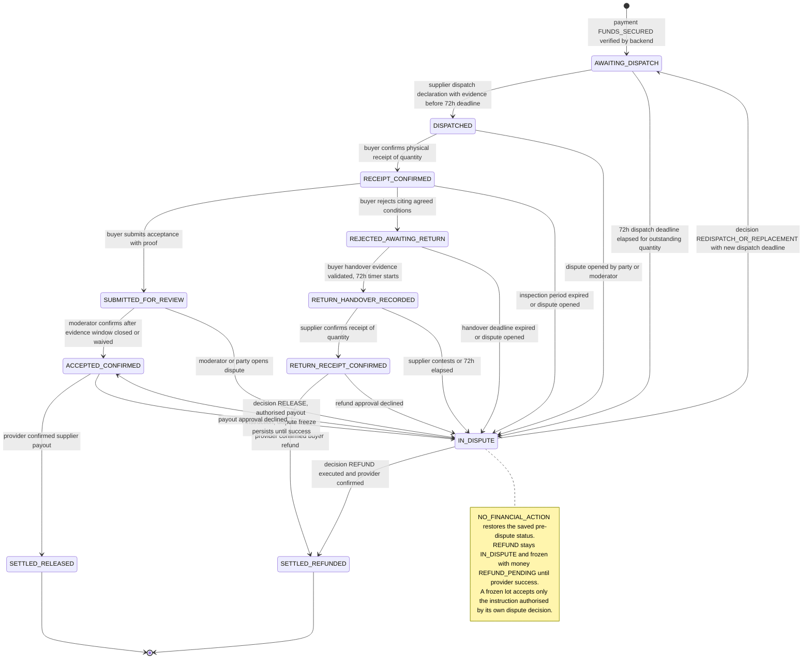

# User Flows

Step-by-step journeys for buyer, supplier and moderator, with the screens each flow needs and the status shown at each step. Status names are the canonical enums in [Transaction State Machine](../03-technical-specs/TRANSACTION_STATE_MACHINE.md#2-canonical-enums).

## 1. Lifecycle at a glance

Each quantity of each line item moves through these item statuses. The same diagram is the lifecycle source in [`diagrams/TRANSACTION_LIFECYCLE.mmd`](../diagrams/TRANSACTION_LIFECYCLE.mmd).

*Diagram source: [`TRANSACTION_LIFECYCLE.mmd`](../diagrams/TRANSACTION_LIFECYCLE.mmd)*

## 2. Buyer journey (Chinedu, Port Harcourt)

| Step | Buyer sees / does | Backend result | Key rule |
|---|---|---|---|
| 1 | Receives an SMS or email invitation and opens the link | Invitation validated (single use, 7 days PROPOSED) | SK-01 |
| 2 | Registers or logs in, verifies phone | Account active | OD-08 |
| 3 | Reviews the line items, quantities, specifications, delivery expectation and the numbered acceptance and rejection conditions | Agreement version displayed with its hash | SK-01 |
| 4 | Agrees to the exact version | Transaction `AWAITING_PAYMENT` | SK-01, SK-03 |
| 5 | Pays through the provider checkout | Payment `PENDING`; UI shows "Confirming payment" | SK-04 |
| 6 | Sees "Funds secured" only after the backend says so | Payment `FUNDS_SECURED`, transaction `FUNDED`, 72h dispatch clock starts | SK-04, SK-05 |
| 7 | Waits; sees dispatch status per quantity and the supplier's deadline | Lots `AWAITING_DISPATCH` then `DISPATCHED` | SK-05 |
| 8 | Receives goods and presses Confirm I received these items, choosing line and quantity | Lots `RECEIPT_CONFIRMED`; buyer delivery-photo requirement created; inspection period starts (PROPOSED) | SK-08 |
| 9 | Must upload delivery photographs for the receipt (due date shown) before accepting or rejecting. Photographs are evidence and do not themselves confirm receipt | Requirement `SUBMITTED`; evidence stored; no status change | SK-08 |
| 10 | Inspects against the agreed conditions. Accepts 3 phones with photos, rejects 2 citing conditions | Accepted: `SUBMITTED_FOR_REVIEW`, both parties notified, evidence window opens. Rejected: `REJECTED_AWAITING_RETURN`, funds held | SK-09, SK-10, SK-11, SK-17 |
| 11 | Arranges the return with a courier of choice and opens a return record | Return `AWAITING_HANDOVER_EVIDENCE`, no timer | SK-12 |
| 12 | Hands goods to the rider and uploads handover photos, rider and courier details | Validated upload sets `handover_evidence_uploaded_at`; lots `RETURN_HANDOVER_RECORDED`; 72h timer starts | SK-14 |
| 13 | Sees supplier confirmation or a dispute notice with an evidence deadline | `RETURN_RECEIPT_CONFIRMED` then refund; or `IN_DISPUTE` | SK-13, SK-15 |
| 14 | In a dispute: reads the notice, uploads more evidence within the window, reads the decision and reasons | Decision recorded, instruction executed by backend | SK-17, SK-18 |

## 3. Supplier journey (Ibrahim, Lagos)

| Step | Supplier does | Backend result |
|---|---|---|
| 1 | Registers; adds payout bank account (name check, VERIFY) | Account ready |
| 2 | Chooses Single item or Multiple items; enters lines, quantities, unit prices, specifications and numbered conditions | `DRAFT` |
| 3 | Sends the transaction to the buyer | `AWAITING_BUYER_AGREEMENT` |
| 4 | Waits for agreement and payment. Sees `FUNDED` only after backend verification | `FUNDED`, `dispatch_deadline_at` visible |
| 5 | Dispatches within 72 hours through own rider or courier. Declares line and quantity, uploads photos, rider and courier details, tracking reference | Lots `DISPATCHED`. Partial dispatch allowed; the rest remains `AWAITING_DISPATCH` |
| 6 | Must upload delivery photographs for each dispatch (due date shown); can add more later | Requirement `SUBMITTED`; evidence only. If late: `OVERDUE`, then `SUBMITTED_LATE`; moderators see it |
| 7 | Receives notice when the buyer submits acceptance; may add evidence during the window | Evidence linked to the review |
| 8 | Receives notice of rejection and return | Lots `REJECTED_AWAITING_RETURN` |
| 9 | After handover evidence, sees the 72-hour confirmation countdown | Timer from server timestamp |
| 10 | Confirms receipt of specific quantities with photos and a condition check, or contests (wrong item, damaged, quantity mismatch, not received) | Confirm: refund-eligible. Contest: dispute opens immediately |
| 11 | Receives payout for moderator-confirmed accepted quantities | `SETTLED_RELEASED` after provider confirmation |
| 12 | In a dispute: submits evidence and statements; reads the decision | |

If the 72-hour dispatch deadline passes with quantity undispatched, the supplier sees a dispute notice for that quantity, can upload late dispatch evidence to the dispute, and cannot use it to bypass the dispute.

## 4. Moderator journey

| Step | Moderator does | Rule |
|---|---|---|
| 1 | Logs in with MFA. Sees queues: acceptance reviews (window open or ready), disputes, windows closing, awaiting second approval, financial exceptions | |
| 2 | Opens a case file: agreement version, per-quantity timeline with server timestamps, evidence from both parties side by side, flags, previous cases | SK-18 |
| 3 | The confirm and decide buttons are disabled while an evidence window or evidence request is open, unless both parties waived | SK-17 |
| 4 | Requests more evidence (who, question, due date) or flags suspicious evidence | |
| 5 | Confirms acceptance, opens a dispute, or records a per-quantity decision with reason and evidence ids | SK-09, SK-17 |
| 6 | The backend creates the instruction with the computed amount. At or above the threshold it is `PENDING_APPROVAL` and a different senior moderator approves; below it it is `QUEUED`. Moderators never type an amount | OD-07 |
| 7 | Sees the instruction execute (or fail, or become `UNKNOWN`). Never edits money | SK-18 |

## 5. Screens required

| Area | Screens |
|---|---|
| Common | Register, OTP, login, profile, payout account, notification centre |
| Supplier | Create transaction (single / multiple), terms and conditions editor, dispatch declaration, delivery photo upload, return receipt (confirm / contest), payout status |
| Buyer | Invitation landing, agreement review, payment and pending, receipt confirmation, acceptance and rejection per quantity, return record and handover upload |
| Shared | Transaction timeline per quantity, evidence viewer, dispute notice, evidence submission, deadline banners (server time) |
| Moderator | Queues, case file, evidence side by side, request evidence, notes, decision form, approvals, financial exceptions, audit search |
| Admin | Staff, configuration, audit, reconciliation exceptions |

Copy rules for UX: say "funds secured" only when status is `FUNDS_SECURED`; never show a photograph as proof; explain that a timer expiry opens a review, not an automatic refund.
