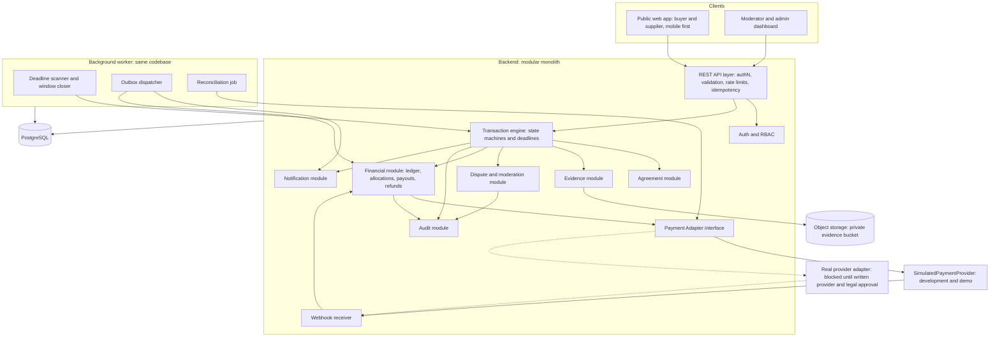
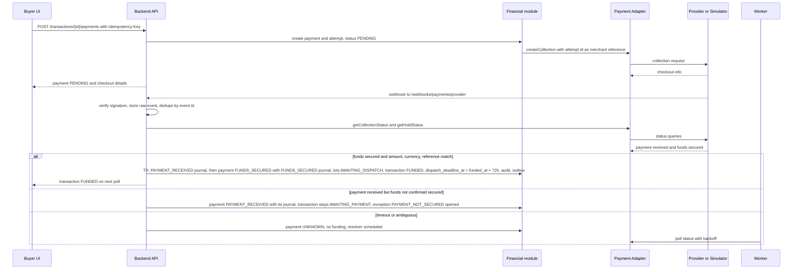

# System Architecture

The MVP architecture, how components communicate, and which component is responsible for each decision. Internal module detail is in [Component Design](COMPONENT_DESIGN.md); security controls are in [Security Architecture](SECURITY_ARCHITECTURE.md).

## 1. Architectural stance

*RECOMMENDED:* a modular monolith: one backend deployable, one PostgreSQL database, one background worker process running the same codebase, one private object store for evidence. No microservices.

*Why.* The hard problem is financial and state consistency. Splitting the transaction engine, ledger and disputes across services would replace local ACID transactions with distributed sagas and multiply failure modes where a bug costs money. A three-person team cannot operate that. Modules with enforced boundaries give separation of concerns without the network.

*Trade-offs accepted.* One deployable scales as a unit (fine for MVP volumes); a bug in one module can crash the process (mitigated by separate API and worker processes and health checks). Revisit if payment isolation is required for compliance or the team grows.

## 2. System context

*Diagram source: [`SYSTEM_ARCHITECTURE.mmd`](../diagrams/SYSTEM_ARCHITECTURE.mmd)*

External parties:

| Party | Interaction |
|---|---|
| Buyers, suppliers | Browser (mobile-first web app) |
| Moderators, admins | Desktop dashboard, MFA required |
| SimulatedPaymentProvider | Used for all development, staging and demos. Behind the Payment Adapter |
| Real payment provider (Paga if verified) | Not integrated until written provider confirmation and Nigerian legal approval. See [Payment Provider Integration](../04-operations/PAYMENT_PROVIDER_INTEGRATION.md) |
| Email provider, optional SMS provider | Notifications |
| Object storage | Evidence files (private bucket, signed URLs) |
| Couriers and riders | Not integrated. Suppliers and buyers arrange them independently; SupplyKey provides no logistics |

## 3. Technology recommendations (RECOMMENDED)

| Layer | Choice | Reason |
|---|---|---|
| Frontend | React with TypeScript, typed API client generated from the OpenAPI contract | Typed contracts; mobile-first |
| Backend | TypeScript (NestJS) or Python (FastAPI or Django); pick the backend engineer's strongest | Consistency over language |
| Database | PostgreSQL with `citext`, `btree_gist` | ACID, row locks, partial unique and exclusion constraints, JSONB |
| Jobs | Postgres-backed queue or Redis-backed queue | Fewer moving parts |
| Storage | S3-compatible, private bucket, short-lived signed URLs | Standard |
| Hosting | Single region, managed Postgres with point-in-time recovery; data-residency to be confirmed (VERIFY) | |

## 4. Frontend architecture

- Two apps in one repository: the public app (buyer and supplier, mobile-first) and the moderator dashboard (desktop-first, separate route tree and build, stricter content security policy).
- State is server-driven. Every transaction response includes `allowed_actions` computed by the backend for the caller. The UI renders controls from that list and never infers permissions from a status.
- Deadlines come from `deadline_at` and `server_time` fields. Countdowns are cosmetic; the server enforces them.
- Uploads go directly to object storage with signed URLs, then are completed and referenced by `evidence_ids` ([API 12](../03-technical-specs/API_SPECIFICATION.md#12-evidence-uploads)). Client-side compression and retry for poor networks.
- Polling (or server-sent events) for status; no websocket dependency in the MVP.
- Copy rules: "Funds secured" only for `FUNDS_SECURED`; a photograph is shown as evidence, never as proof; a timer expiry is described as "opens a review", never "automatic refund".

## 5. Backend authority: who decides what

| Component | Responsible for | Decides | Must never |
|---|---|---|---|
| Frontend | Rendering, input, compression, showing server state | Nothing about money or state | Compute whether funds can be released; hold deadlines; trust local state |
| API layer | AuthN, validation, rate limits, idempotency, response envelope | Request validity | Contain business rules |
| Auth and RBAC | Sessions, staff MFA, role, ownership and state checks | Who may call what on which object | |
| Transaction engine | All state machines and transitions | Whether a transition is legal | Call the provider directly |
| Agreement module | Versioning, hashing, immutability | Whether terms are locked | |
| Evidence module | Signed uploads, hashing, flags, linking | Evidence integrity record | Delete evidence |
| Dispute and moderation module | Windows, requests, decisions, approvals | Whether a decision may be recorded | Edit the ledger |
| Financial module | Allocation, ledger, instructions, idempotency, reconciliation | Whether an instruction may be created and executed | Act on unverified input |
| Payment adapter | Translate to and from the provider; normalise results | Nothing; returns facts or `UNKNOWN` | Leak provider types into the engine |
| Worker | Deadlines, windows, outbox, resolver, reconciliation | When time-based events fire, from server clock | Bypass the transaction engine |
| Moderator | Human judgement | Case outcome | Edit money; approve own decision |

The frontend sends intents ("I accept 3 of unit group X"); the backend decides consequences.

## 6. How components communicate

| From | To | Mechanism |
|---|---|---|
| Browser | API | HTTPS JSON, bearer token, `Idempotency-Key` on state changes |
| Browser | Object storage | Direct upload with a signed URL obtained from the API |
| API | Database | Single transaction per state change; row locks; audit and outbox rows written in the same transaction |
| Outbox worker | Provider via adapter | After commit; never inside the transition transaction |
| Provider | API | Signed webhook, stored raw, then verified by an independent status query |
| Worker | Transaction engine | Same transition functions as the API |
| Notification module | Email and SMS providers | Outbox with retry; failure never rolls back a transition |

## 7. Payment flow

*Diagram source: [`PAYMENT_FLOW.mmd`](../diagrams/PAYMENT_FLOW.mmd)*

Key points: the webhook alone never funds a transaction; the backend queries status and verifies amount, currency and reference; `PAYMENT_RECEIVED` is distinct from `FUNDS_SECURED`; ambiguity ends in `UNKNOWN`, never an assumption.

## 8. Deployment and operations

| Concern | Decision |
|---|---|
| Environments | Local, staging (SimulatedPaymentProvider), production (disabled for real money until gates clear) |
| Processes | `api` and `worker` from one codebase; `worker` has a leader lock for schedulers |
| Backups | Daily encrypted, point-in-time recovery, restore drill before pilot |
| Observability | Structured logs without secrets, error tracking, alerts on stuck states, `UNKNOWN` instructions, reconciliation exceptions, scanner lag |
| Kill switch | One admin switch stops all provider submissions |

## 9. Related documents

[Component Design](COMPONENT_DESIGN.md) · [Security Architecture](SECURITY_ARCHITECTURE.md) · [Payment Provider Integration](../04-operations/PAYMENT_PROVIDER_INTEGRATION.md) · [State Machine](../03-technical-specs/TRANSACTION_STATE_MACHINE.md)
