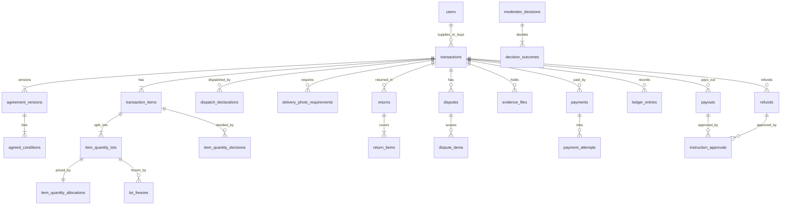

# Database Specification

PostgreSQL schema for SupplyKey: tables, fields, keys, constraints, indexes and invariants, including the quantity-level model used for partial dispatch, acceptance, returns and settlement. Status values come only from the [canonical enums](TRANSACTION_STATE_MACHINE.md#2-canonical-enums).

## 1. Conventions

- PostgreSQL. Primary keys are `uuid` (v7 preferred). Money is `bigint` kobo in columns named `*_kobo`, with `currency char(3) = 'NGN'`. Timestamps are `timestamptz` in UTC.
- Enumerations are `text` with `CHECK` constraints (or Postgres enums) that contain exactly the canonical values.
- Mutable tables have `created_at`, `updated_at` and `version int` for optimistic locking.
- Append-only tables (application role has INSERT and SELECT only; triggers reject UPDATE and DELETE): `ledger_entries`, `audit_log`, `agreement_versions`, `agreed_conditions`, `moderator_decisions`, `decision_outcomes`, `instruction_approvals`, `lot_freezes` (rows are closed by setting `released_at` only), `provider_events`, `evidence_files` (content columns), `moderator_notes`, `evidence_window_waivers`.
- Foreign keys are `ON DELETE RESTRICT`. Nothing financial is ever deleted.
- Extensions: `citext`, `btree_gist`.

## 2. Entity overview

*Diagram source: [`DATABASE_ER.mmd`](../diagrams/DATABASE_ER.mmd)*

## 3. Identity and configuration

### `users`

| Field | Type | Constraints |
|---|---|---|
| id | uuid | PK |
| email | citext | UNIQUE, nullable |
| phone_e164 | text | UNIQUE, nullable; `CHECK (email IS NOT NULL OR phone_e164 IS NOT NULL)` |
| password_hash | text | NOT NULL |
| role | text | `USER`, `MODERATOR`, `SENIOR_MODERATOR`, `ADMIN` |
| status | text | `ACTIVE`, `SUSPENDED`, `CLOSED` |
| mfa_secret_enc | bytea | Required for staff roles (CHECK) |
| failed_login_count, locked_until | int, timestamptz | |

### `user_profiles`

| Field | Type | Notes |
|---|---|---|
| user_id | uuid | PK, FK `users` |
| display_name, business_name | text | |
| kyc_level | smallint | Meaning OPEN ([OD-08](../06-delivery/OPEN_DECISIONS.md)) |
| state_of_residence, address | text | |
| bank_code, account_number_enc, account_name | text | Supplier payout destination |
| bank_verified_at | timestamptz | Payout requires verification |
| bank_effective_at | timestamptz | Change cool-down 24h (PROPOSED) |

Buyer and supplier are not separate tables. Role is per transaction.

### `system_config` and `config_history`

`system_config(key PK, value jsonb, effective_from)`. Keys are listed in [Business Rules 2](../01-product/BUSINESS_RULES.md#2-deadlines-and-configuration). `config_history` is append-only. Admin changes need a second admin.

## 4. Transactions and agreement

### `transactions`

| Field | Type | Constraints |
|---|---|---|
| id | uuid | PK |
| reference | text | UNIQUE, e.g. `SK-2026-000123` |
| supplier_id | uuid | FK `users`, NOT NULL |
| buyer_id | uuid | FK `users`, nullable until invitation accepted; `CHECK (buyer_id IS NULL OR buyer_id <> supplier_id)` |
| status | text | `DRAFT`, `AWAITING_BUYER_AGREEMENT`, `AWAITING_PAYMENT`, `FUNDED`, `COMPLETED`, `CANCELLED`, `EXPIRED` |
| current_agreement_version_id | uuid | FK `agreement_versions` |
| goods_total_kobo | bigint | `CHECK >= 0`; equals sum of `line_total_kobo` |
| delivery_fee_kobo | bigint | `CHECK >= 0`, default 0 |
| platform_fee_kobo | bigint | `CHECK >= 0`, default 0 (OPEN, [OD-06](../06-delivery/OPEN_DECISIONS.md)) |
| total_payable_kobo | bigint | `CHECK = goods_total_kobo + delivery_fee_kobo + platform_fee_kobo` (who pays each is OPEN, [OD-05](../06-delivery/OPEN_DECISIONS.md)) |
| funded_at | timestamptz | Set once, only by P3 |
| dispatch_deadline_at | timestamptz | `funded_at + dispatch_deadline_hours` (72); set once |
| config_snapshot | jsonb | Deadlines and thresholds at funding time |
| version | int | |

`CHECK (status <> 'FUNDED' OR funded_at IS NOT NULL)`.

### `transaction_invitations`

`id` PK; `transaction_id` FK; `contact` (email or phone); `token_hash` UNIQUE; `expires_at`; `used_at`; `status` (`ACTIVE`, `USED`, `EXPIRED`).

### `transaction_items` (line items)

One row per distinct product, variant or price line. Not one row per physical unit.

| Field | Type | Constraints |
|---|---|---|
| id | uuid | PK |
| transaction_id | uuid | FK NOT NULL |
| line_no | int | `UNIQUE (transaction_id, line_no)` |
| description, specification, condition_text | text | NOT NULL |
| quantity | int | `CHECK > 0` |
| unit_price_kobo | bigint | `CHECK > 0` |
| line_total_kobo | bigint | `CHECK = quantity * unit_price_kobo` |

### `agreement_versions` (immutable)

`id` PK; `transaction_id` FK; `version_no` (`UNIQUE (transaction_id, version_no)`); `terms_json` (items, quantities, prices, conditions, delivery expectations, fees); `content_hash` char(64) SHA-256 of canonical JSON; `created_by`; `supplier_confirmed_at`; `buyer_agreed_at`; `buyer_agreed_ip`. `terms_json` also holds the delivery expectation (destination, expected delivery days), fee payer and general terms. A trigger blocks new versions once any `payment_attempts` row exists for the transaction. Partial unique index: at most one buyer-agreed current version per transaction.

### `agreed_conditions` (immutable)

`id` PK; `agreement_version_id` FK; `item_id` FK nullable (null = whole transaction); `code` (for example `SEALED`, `SPEC_MATCH`, `QTY`, `DAMAGE_FREE`); `kind` (`ACCEPTANCE` or `REJECTION`); `text`. Rejections reference these ids, which ties every rejection to the agreement.

## 5. Quantity model

Partial acceptance, dispatch, returns and refunds operate at item-quantity level without creating a row for every physical unit (SK-16).

*RECOMMENDED design: quantity lots.* A *lot* is a contiguous range of unit numbers of one line item that currently share the same status and money position. At funding, each line item gets one lot covering units `1..quantity`. When an action covers part of a lot, the backend splits the lot into two lots (for example units 1-3 and 4-5) and moves only the relevant lot. A 5-phone line is at most a handful of rows, never five-per-unit by default.

### `item_quantity_lots`

| Field | Type | Constraints |
|---|---|---|
| id | uuid | PK |
| item_id | uuid | FK `transaction_items` |
| unit_start, unit_end | int | `CHECK (unit_start >= 1 AND unit_end >= unit_start)` |
| quantity | int | Generated: `unit_end - unit_start + 1` |
| item_status | text | The 11 canonical values in [State Machine 2.3](TRANSACTION_STATE_MACHINE.md#23-item-lot-status) |
| pre_dispute_status | text | Saved when entering `IN_DISPUTE` |
| money_status | text | `HELD`, `RELEASE_PENDING`, `RELEASED`, `REFUND_PENDING`, `REFUNDED` |
| is_frozen | boolean | Denormalised: true while any `lot_freezes` row for the lot is active; maintained only by the transition functions |
| dispatch_id | uuid | FK `dispatch_declarations`, set at dispatch; kept when the lot splits |
| receipt_confirmation_id | uuid | FK `receipt_confirmations`, set at receipt confirmation; kept when the lot splits |
| version | int | |

Constraints:

- `EXCLUDE USING gist (item_id WITH =, int4range(unit_start, unit_end, '[]') WITH &&)`: lots of one item never overlap.
- Deferred constraint trigger: the lots of an item always cover exactly `1..transaction_items.quantity`.
- `CHECK (money_status = 'RELEASED') = (item_status = 'SETTLED_RELEASED')` and the same for `REFUNDED` and `SETTLED_REFUNDED`.
- `CHECK (item_status <> 'IN_DISPUTE' OR is_frozen)`.

### `lot_freezes`

One row per active or past freeze of a lot. A lot can have several at once (for example a dispute freeze and a provider-unknown freeze).

| Field | Type | Constraints |
|---|---|---|
| id | uuid | PK |
| lot_id | uuid | FK `item_quantity_lots` |
| reason | text | `DISPUTE`, `PROVIDER_UNKNOWN`, `RECONCILIATION` |
| dispute_id | uuid | FK `disputes`; required when `reason = DISPUTE` |
| instruction_type, instruction_id | text, uuid | Required when `reason = PROVIDER_UNKNOWN` |
| created_at, created_by_event | timestamptz, text | The transition that added the freeze |
| released_at, released_by_event | timestamptz, text | A row is closed by setting these; never deleted |

`CHECK ((reason = 'DISPUTE') = (dispute_id IS NOT NULL))`. Creating and releasing a freeze writes an `audit_log` row in the same transaction. When a lot is split, the sub-lots receive copies of its active freezes. Partial unique index: one active `DISPUTE` freeze per `(lot_id, dispute_id)`.
- `CHECK (item_status <> 'IN_DISPUTE' OR is_frozen)`.

### `item_quantity_allocations`

One row per lot (`lot_id` UNIQUE). This allocation record is keyed by lot.

| Field | Type | Notes |
|---|---|---|
| lot_id | uuid | PK, FK |
| item_id, quantity | | Copied for convenience |
| gross_amount_kobo | bigint | `quantity * unit_price_kobo` |
| delivery_fee_share_kobo | bigint | Apportioned, see [Financial Engine 3](FINANCIAL_ENGINE.md#3-allocation) |
| platform_fee_share_kobo | bigint | Apportioned |
| allocated_kobo | bigint | Generated: gross + delivery share + platform share |
| released_kobo, refunded_kobo | bigint | Derived from the ledger; verified nightly |
| pending_payout_kobo, pending_refund_kobo | bigint | Reserved by instructions in `PENDING_APPROVAL`, `QUEUED`, `SUBMITTED` or `UNKNOWN` |
| remaining_held_kobo | bigint | `allocated - released - refunded - pending_payout - pending_refund` |

`CHECK (released_kobo + refunded_kobo + pending_payout_kobo + pending_refund_kobo <= allocated_kobo)`. When a lot splits, its allocation splits by the same unit ranges and the two allocations sum to the original.

### `item_quantity_decisions` (buyer acceptance and rejection submissions)

| Field | Type | Constraints |
|---|---|---|
| id | uuid | PK |
| submission_id | uuid | Groups lines submitted together; one evidence window per submission |
| transaction_id, item_id | uuid | FKs |
| quantity_submitted | int | Quantity the buyer is deciding on, `> 0` |
| quantity_accepted | int | `>= 0` |
| quantity_rejected | int | `>= 0` |
| submitted_by | uuid | FK `users`; must be the transaction buyer |
| submitted_at | timestamptz | |
| review_status | text | `SUBMITTED_FOR_REVIEW`, `EVIDENCE_REQUESTED`, `CONFIRMED`, `DISPUTED`; NULL iff `quantity_accepted = 0` |
| evidence_window_id | uuid | FK `evidence_windows`; required when `quantity_accepted > 0` |
| reason_text | text | Supplemental rejection explanation |

`CHECK (quantity_accepted + quantity_rejected <= quantity_submitted)`. Application and trigger enforce that `quantity_submitted` is covered by lots currently `RECEIPT_CONFIRMED` (so accepted + rejected never exceed confirmed-received quantity).
`rejection_conditions(decision_id, agreed_condition_id)` with PK on both: a decision with `quantity_rejected > 0` must have at least one row (deferred trigger).

## 6. Dispatch, receipt and returns

### `dispatch_declarations` / `dispatch_items`

`dispatch_declarations`: `id`, `transaction_id`, `declared_by` (must be supplier), `courier_name`, `rider_name`, `rider_phone`, `tracking_ref`, `declared_at`, `expected_delivery_days` (copied from the agreed terms), `note`. `dispatch_items`: `dispatch_id`, `item_id`, `quantity > 0`. The deadline check (`declared_at < dispatch_deadline_at`) is enforced in the transition function, not by the client. Evidence is linked through `evidence_files.related_entity_type = 'DISPATCH'`.

### `receipt_confirmations`

`id`, `transaction_id`, `item_id`, `quantity > 0`, `confirmed_by` (buyer), `confirmed_at`, `inspection_deadline_at` (nullable until [OD-01](../06-delivery/OPEN_DECISIONS.md) approved). Delivery photographs are not stored here; they are evidence only.

### `delivery_photo_requirements`

One row for each party obligation to submit delivery photographs: the supplier for each dispatch declaration, the buyer for each receipt confirmation. Requirements are PROPOSED operating rules ([OD-16](../06-delivery/OPEN_DECISIONS.md)); the obligation that both parties submit photographs is confirmed.

| Field | Type | Constraints |
|---|---|---|
| id | uuid | PK |
| transaction_id | uuid | FK NOT NULL |
| party_role | text | `BUYER` or `SUPPLIER` |
| source_type, source_id | text, uuid | `DISPATCH` + `dispatch_declarations.id` (supplier) or `RECEIPT_CONFIRMATION` + `receipt_confirmations.id` (buyer); `UNIQUE (party_role, source_type, source_id)` |
| status | text | `PENDING`, `SUBMITTED`, `OVERDUE`, `SUBMITTED_LATE` |
| due_at | timestamptz | Nullable for the buyer until OD-01 is approved; recomputed only by DP1 (earlier only) |
| submitted_at | timestamptz | Set once when the first `DELIVERY_PHOTO` evidence is linked |

`CHECK ((party_role = 'SUPPLIER') = (source_type = 'DISPATCH'))`. `status` moves only `PENDING` to `SUBMITTED` or `OVERDUE`, and `OVERDUE` to `SUBMITTED_LATE`. Photographs link through `evidence_files` with `purpose = 'DELIVERY_PHOTO'`, `related_entity_type = 'DELIVERY_PHOTO_REQUIREMENT'`. The requirement never changes a lot's status.
### `returns` / `return_items`

| `returns` field | Type | Notes |
|---|---|---|
| id, transaction_id | uuid | |
| status | text | `AWAITING_HANDOVER_EVIDENCE`, `HANDOVER_RECORDED`, `RECEIPT_CONFIRMED`, `IN_DISPUTE`, `CLOSED` |
| initiated_by | uuid | Buyer |
| courier_name, rider_name, rider_phone, tracking_ref | text | Set with handover evidence |
| handover_evidence_id | uuid | FK `evidence_files`, nullable |
| handover_evidence_uploaded_at | timestamptz | Server time of validated upload; the 72h start; set once |
| confirmation_deadline_at | timestamptz | `handover_evidence_uploaded_at + return_confirmation_hours` (72); set once |
| handover_due_at | timestamptz | PROPOSED 7 days from rejection |

`CHECK (status <> 'HANDOVER_RECORDED' OR (handover_evidence_uploaded_at IS NOT NULL AND confirmation_deadline_at IS NOT NULL))`. Triggers reject updates of the two timestamp columns once set.

`return_receipt_confirmations`: `id`, `return_id`, `item_id`, `quantity`, `condition_matches_original`, `confirmed_by` (supplier), `confirmed_at`; evidence links through `evidence_files`. One row per supplier confirmation, so partial confirmations are recorded individually.

`return_items`: `return_id`, `item_id`, `quantity_returned`, `quantity_received_confirmed`, `quantity_contested`, all `>= 0`.
`CHECK (quantity_received_confirmed + quantity_contested <= quantity_returned)`; deferred trigger: `quantity_returned <= rejected quantity` of the item not already returned or refunded; `quantity_received_confirmed <= buyer handover quantity`. Outstanding = `returned - confirmed - contested`.

## 7. Evidence, windows and requests

### `evidence_files`

| Field | Type | Notes |
|---|---|---|
| id | uuid | PK |
| transaction_id | uuid | FK NOT NULL |
| item_id | uuid | FK nullable; quantity context is in `meta` |
| uploaded_by | uuid | FK |
| party_role | text | `BUYER`, `SUPPLIER`, `MODERATOR` |
| purpose | text | See [State Machine 2.10](TRANSACTION_STATE_MACHINE.md#210-other-enums) |
| related_entity_type, related_entity_id | text, uuid | The event it supports (dispatch, decision, return, dispute, request) |
| storage_key | text | |
| sha256 | char(64) | Index for duplicate detection |
| mime_type, size_bytes | | |
| exif_json | jsonb | Informational only |
| caption | text | |
| server_received_at | timestamptz | Trusted time |
| status | text | `UPLOADING`, `VERIFIED` (upload complete, hash re-computed and matching), `LINKED` (attached to an event by a transition), `RETIRED`. Only `VERIFIED` files can be referenced by an action |
| flags | text[] | `DUPLICATE_HASH`, `NO_EXIF`, `EXIF_TIME_MISMATCH`, `MODERATOR_SUSPICIOUS` |
| retired_at, retired_reason | | Admin, with reason; original kept |

Delivery photographs: `purpose = 'DELIVERY_PHOTO'`, `party_role` is `BUYER` or `SUPPLIER`. There is no receipt side effect.

### `evidence_windows`, `evidence_window_waivers`, `evidence_requests`

`evidence_windows`: `id`, `subject_type` (`ACCEPTANCE_REVIEW` or `DISPUTE`), `subject_id`, `opens_at`, `ends_at`, `status` (`OPEN`, `CLOSED_ELAPSED`, `CLOSED_WAIVED`), `extended_once` boolean, `extension_reason`.
`evidence_window_waivers`: `window_id`, `party_role` (`BUYER`/`SUPPLIER`), `user_id`, `waived_at`; `PRIMARY KEY (window_id, party_role)`. The window may become `CLOSED_WAIVED` only when both rows exist.
`evidence_requests`: `id`, `subject_type`, `subject_id`, `requested_party`, `question`, `due_at`, `requested_by`, `status` (`OPEN`, `FULFILLED`, `EXPIRED`).

## 8. Disputes and moderation

### `disputes`

`id`; `transaction_id` FK; `return_id` FK nullable; `reason_code` and `origin` per [State Machine 2.8](TRANSACTION_STATE_MACHINE.md#28-dispute-disputesstatus); `status`; `opened_at`; `evidence_window_id` FK; `assigned_moderator_id`; `requires_second_approval` boolean.

Partial unique indexes (prevent duplicate automatic disputes):

- `UNIQUE (transaction_id) WHERE reason_code = 'NO_DISPATCH' AND status <> 'CLOSED'`
- `UNIQUE (return_id) WHERE return_id IS NOT NULL AND status <> 'CLOSED'`: one open dispute per return; additional outstanding quantity is appended to its `dispute_items`.

`dispute_items`: `dispute_id`, `lot_id`, `item_id`, `quantity`, `issue_code` (for return disputes: `WRONG_ITEM`, `DAMAGED`, `QUANTITY_MISMATCH`, `NOT_RECEIVED`, `NOT_CONFIRMED`), `UNIQUE (dispute_id, lot_id)`.
`dispute_statements`: `id`, `dispute_id`, `author_id`, `body`, `kind` (`STATEMENT`, `CONSENT`), `created_at` (append-only).
`moderator_notes`: `id`, `subject_type`, `subject_id`, `moderator_id`, `body`, `created_at` (append-only, internal).

### `moderator_decisions` (immutable) and `decision_outcomes`

`moderator_decisions`: `id`; `decision_kind` (`ACCEPTANCE_CONFIRMATION`, `DISPUTE_DECISION`); `subject_type`/`subject_id`; `moderator_id`; `reason` text NOT NULL; `evidence_ids_considered` uuid[]; `requires_second_approval` boolean; `supersedes_id`; `created_at`. A changed mind is a new decision that supersedes; the old one is never edited.
`decision_outcomes`: `decision_id`, `item_id`, `lot_id`, `quantity`, `outcome` (`RELEASE`, `REFUND`, `REDISPATCH_OR_REPLACEMENT`, `NO_FINANCIAL_ACTION`), `amount_kobo`, `new_dispatch_deadline_at` (required for `REDISPATCH_OR_REPLACEMENT`). There is no `SPLIT` value. A partial decision uses `RELEASE` and `REFUND` rows over different sub-lots.

*Amount enforcement (OD-14 made enforceable).* Constraints on `decision_outcomes`:

- `CHECK (quantity > 0)` and a trigger that `quantity` equals the quantity of `lot_id` (sub-lots are split first).
- For `RELEASE` and `REFUND`: a trigger requires `amount_kobo = instruction_amount(lot)`, the backend-computed amount derived from `item_quantity_allocations` ([Financial Engine 4.1](FINANCIAL_ENGINE.md#41-amount-rule-enforceable)). Any other value is rejected, whether higher or lower.
- For `REDISPATCH_OR_REPLACEMENT` and `NO_FINANCIAL_ACTION`: `CHECK (amount_kobo = 0)`.
- `CHECK (outcome <> 'REDISPATCH_OR_REPLACEMENT' OR new_dispatch_deadline_at IS NOT NULL)`.

The same trigger applies to `payout_items.amount_kobo` and `refund_items.amount_kobo`. An amount-level adjustment (price reduction, partial compensation) is not representable without an approved mechanism ([OD-14](../06-delivery/OPEN_DECISIONS.md)).

`instruction_approvals` (append-only): `id`, `instruction_type` (`PAYOUT`, `REFUND`), `instruction_id`, `approver_id`, `approved` boolean, `reason`, `created_at`. Trigger: approver role must be `SENIOR_MODERATOR`; `approver_id` must differ from `moderator_decisions.moderator_id` of the instruction's decision (when `origin_type` has one); only one approving row per instruction; an instruction may leave `PENDING_APPROVAL` for `QUEUED` only if such a row exists. Approvals attach to the instruction because it carries the amount.

## 9. Payments, ledger and instructions

Detail and journals: [Financial Engine](FINANCIAL_ENGINE.md).

| Table | Key fields and constraints |
|---|---|
| `payments` | `id`, `transaction_id`, `amount_kobo`, `currency`, `status` (`PENDING`, `PAYMENT_RECEIVED`, `FUNDS_SECURED`, `FAILED`, `EXPIRED`, `UNKNOWN`), `provider_name`, `provider_ref`, `confirmed_at`, `secured_at`, `mode` (`SIMULATED`, `PRODUCTION`). Partial unique index: at most one `FUNDS_SECURED` payment per transaction |
| `payment_attempts` | `id` (merchant reference), `payment_id`, `idempotency_key` UNIQUE, `attempt_no`, `status`, `request_payload` jsonb, `response_payload` jsonb, `error_code`, `initiated_at`, `resolved_at` |
| `provider_events` | `id`, `provider_name`, `provider_event_id`, `event_type`, `raw_body` jsonb, `signature_valid`, `received_at`, `processed_at`, `processing_result`. UNIQUE (provider_name, provider_event_id) (hash of body if the provider supplies no id, VERIFY) |
| `ledger_accounts` | `id`, `code`, `type`. Codes: `PROVIDER_CLEARING`, `RECEIVED_UNSECURED`, `HELD_FUNDS`, `SUPPLIER_PAYABLE`, `BUYER_REFUNDABLE`, `PLATFORM_FEE_REVENUE`, `PROVIDER_FEES`, `UNALLOCATED_OVERPAYMENT` |
| `ledger_entries` | Append-only. `id`, `journal_id`, `transaction_id`, `item_id`, `lot_id`, `account_id`, `direction` (`DEBIT`/`CREDIT`), `amount_kobo > 0`, `entry_type` (`PAYMENT_RECEIVED`, `FUNDS_SECURED`, `RELEASE_AUTHORIZED`, `PAYOUT_SENT`, `REFUND_AUTHORIZED`, `REFUND_SENT`, `FEE_ACCRUED`, `REVERSAL`, `ADJUSTMENT`), `related_entity_type`, `related_entity_id`, `reverses_entry_id`, `reason`, `created_by`, `created_at`. Deferred trigger: each `journal_id` sums to zero. `UNIQUE (related_entity_type, related_entity_id, entry_type, account_id, direction, lot_id)` for idempotent posting |
| `payouts` | `id`, `transaction_id`, `supplier_id`, `amount_kobo`, `status` (`PENDING_APPROVAL`, `QUEUED`, `SUBMITTED`, `SUCCEEDED`, `FAILED`, `UNKNOWN`, `CANCELLED`), `idempotency_key` UNIQUE, `provider_ref`, `destination_snapshot` jsonb, `origin_type` (`ACCEPTANCE_CONFIRMATION`, `RETURN_RECEIPT_CONFIRMATION`, `DISPUTE_DECISION`; NOT NULL), `origin_id` (decision id or return id; NOT NULL), `retry_of_id` (nullable self-reference), `requires_approval` boolean, `failure_reason`. `CHECK (amount_kobo > 0)` |
| `payout_items` | `payout_id`, `item_id`, `lot_id`, `quantity`, `amount_kobo` (must equal `instruction_amount(lot)`). Partial UNIQUE (lot_id) where parent status not in (`FAILED`, `CANCELLED`); `SUM(amount_kobo)` of items equals `payouts.amount_kobo` |
| `refunds`, `refund_items` | Same shape and constraints, including `origin_type`, `origin_id`, `retry_of_id`; buyer destination per provider (VERIFY). Partial UNIQUE (lot_id) for non-failed, non-cancelled refunds |

Reservations are the `pending_payout_kobo` and `pending_refund_kobo` columns of `item_quantity_allocations`, updated with the instruction items in the same transaction; see [Financial Engine 2](FINANCIAL_ENGINE.md#2-ledger-accounts-and-journals).

`financial_exceptions`: `id`, `kind` (`INSTRUCTION_FAILED`, `INSTRUCTION_UNKNOWN`, `PAYMENT_NOT_SECURED`, `RECONCILIATION_MISMATCH`, `OVERPAYMENT`), `subject_type`, `subject_id`, `status` (`OPEN`, `RESOLVED`), `opened_at`, `resolved_by`, `resolved_at`, `resolution_action` (`RETRY`, `RELEASE`, `CONFIRM_NOT_EXECUTED`, `RECORD_ADJUSTMENT`), `resolution_reason`. Resolution is by a `SENIOR_MODERATOR`; the row is never deleted.

Guards enforced by triggers on instruction and item creation:

1. A lot may have a non-failed payout item or a non-failed refund item, never both, and its allocation invariant must still hold.
2. Frozen lots. If the lot has any active `lot_freezes` row of reason `PROVIDER_UNKNOWN` or `RECONCILIATION`, creation is refused. If it has `DISPUTE` freezes, a normal instruction is allowed only when `origin_type = DISPUTE_DECISION`, the decision's dispute equals the freeze's `dispute_id` for every active dispute freeze, and the decision was recorded after that dispute's evidence window closed (`CLOSED_ELAPSED` or `CLOSED_WAIVED`). A retry is allowed only through F10 after the failed instruction's authorisation journal has been reversed and its reservation released; it must link to that failed instruction and preserve its origin, lots, amount and destination snapshot. For a dispute-frozen lot, the origin decision must be the decision of that same dispute. Otherwise `LOT_FROZEN`.
3. Moving an instruction from `QUEUED` to `SUBMITTED` re-checks guard 2.
4. `PENDING_APPROVAL` is required when `amount_kobo >= high_value_threshold_kobo` (snapshotted at funding) or the decision is flagged; the trigger refuses `QUEUED` creation otherwise.
5. A `PENDING_APPROVAL` instruction cannot have ledger entries; the authorisation journal is accepted only for `QUEUED`, `SUBMITTED` or later instructions. A retry cannot be inserted until the prior failed instruction's authorisation journal is reversed and its reservation released; the retry must retain the prior instruction's origin, lot allocation and destination snapshot while using a new idempotency key.

## 10. Notifications, audit and idempotency

| Table | Key fields |
|---|---|
| `notifications` | `id`, `user_id`, `type`, `entity_type`, `entity_id`, `channel` (`IN_APP`, `EMAIL`, `SMS`), `payload` jsonb, `status` (`QUEUED`, `SENT`, `FAILED`, `READ`), `attempts`, `sent_at`, `read_at`. Doubles as the outbox |
| `audit_log` | Append-only. `id` bigserial, `transaction_id`, `actor_user_id` (null = system), `actor_role`, `action`, `entity_type`, `entity_id`, `before_json`, `after_json`, `request_id`, `ip`, `user_agent`, `prev_hash`, `row_hash`, `created_at`. Hash chain per transaction |
| `idempotency_keys` | `key`, `user_id`, `endpoint`, `request_hash`, `response_snapshot`, `created_at`, `expires_at`. `UNIQUE (user_id, endpoint, key)`; retention 24h, financial endpoints 30 days |
| `serialised_goods_units` (optional) | `id`, `item_id`, `unit_no`, `serial_or_imei`, `captured_at`. Only for categories that need it; never required for every product |

## 11. Key indexes

| Index | Purpose |
|---|---|
| `transactions(supplier_id, status)`, `transactions(buyer_id, status)` | Lists |
| `transactions(dispatch_deadline_at) WHERE status = 'FUNDED'` | Dispatch scanner |
| `item_quantity_lots(item_id, item_status)`, partial on `item_status = 'AWAITING_DISPATCH'` | Scanner and rollups |
| `returns(confirmation_deadline_at) WHERE status = 'HANDOVER_RECORDED'` | Return scanner |
| `receipt_confirmations(inspection_deadline_at)` | Inspection scanner (once approved) |
| `evidence_windows(ends_at) WHERE status = 'OPEN'` | Window closer |
| `delivery_photo_requirements(due_at) WHERE status = 'PENDING'` | Overdue scanner |
| `lot_freezes(lot_id) WHERE released_at IS NULL` | Fast frozen-lot check |
| `payouts(status)`, `refunds(status)` partial on `PENDING_APPROVAL` | Approval queue |
| `evidence_requests(due_at) WHERE status = 'OPEN'` | Request expiry |
| `evidence_files(sha256)`, `evidence_files(transaction_id, purpose)` | Duplicate detection, case file |
| `ledger_entries(transaction_id, lot_id)` | Balances |
| `provider_events(provider_name, provider_event_id)` unique | Webhook dedupe |
| `disputes(status)`, `audit_log(transaction_id, created_at)` | Queues, audit |

## 12. Invariants (enforced in code, constraints and nightly verification)

1. Lots of each item cover exactly `1..quantity`, never overlap.
2. `accepted + rejected <= quantity confirmed received` for each decision.
3. `returned <= rejected`; `supplier_confirmed <= buyer_handover`; `confirmed + contested <= returned`.
4. `released + refunded + pending_payout + pending_refund <= allocated` per lot.
5. A lot never has both a settled or pending payout and a settled or pending refund.
6. Every ledger journal sums to zero; no ledger or audit row is ever updated or deleted.
7. `HELD_FUNDS` for a transaction equals the sum of `remaining_held_kobo` over its lots plus pending instructions not yet journalled out.
8. `dispatch_deadline_at`, `handover_evidence_uploaded_at` and `confirmation_deadline_at` are set once and never changed.
9. A lot with an active `DISPUTE` freeze has an instruction only if that instruction's `origin_type` is `DISPUTE_DECISION` of the freezing dispute; a lot with an active `PROVIDER_UNKNOWN` or `RECONCILIATION` freeze has no creatable or submittable instruction.
10. `decision_outcomes.amount_kobo`, `payout_items.amount_kobo` and `refund_items.amount_kobo` equal the computed lot allocation amount for `RELEASE` and `REFUND`.
11. An instruction at or above the threshold (or flagged) has an approving `instruction_approvals` row by a different `SENIOR_MODERATOR` before its authorisation journal exists.

## 13. Workflow support checklist

| Workflow | Supported by |
|---|---|
| Multiple items, quantities | `transaction_items.quantity`, lots |
| Partial dispatch | `dispatch_items.quantity`, lot split to `DISPATCHED` |
| Photo evidence from both parties, required of each | `evidence_files.party_role`, `purpose = DELIVERY_PHOTO`, `delivery_photo_requirements` |
| Frozen-lot protection and authorised dispute instructions | `lot_freezes`, instruction guards, `origin_type` |
| High-value approval | `instruction_approvals`, `requires_approval`, threshold snapshot |
| No amount-level settlement | `decision_outcomes` and item amount triggers |
| Separate receipt confirmation | `receipt_confirmations` |
| Acceptance with window and moderator confirmation | `item_quantity_decisions`, `evidence_windows`, `moderator_decisions` |
| Rejection tied to agreement | `rejection_conditions` to `agreed_conditions` |
| Return timer from validated upload | `returns.handover_evidence_uploaded_at`, `confirmation_deadline_at` |
| Partial return confirmation | `return_items.quantity_received_confirmed` |
| Scoped disputes | `dispute_items` |
| No duplicate payout or refund | Partial unique indexes on `payout_items` and `refund_items`, idempotency keys |
| Immutable money history | Append-only ledger, compensating journals |

## 14. Related documents

[State Machine](TRANSACTION_STATE_MACHINE.md) · [API](API_SPECIFICATION.md) · [Financial Engine](FINANCIAL_ENGINE.md) · [Evidence and Files](../04-operations/EVIDENCE_AND_FILE_HANDLING.md)
