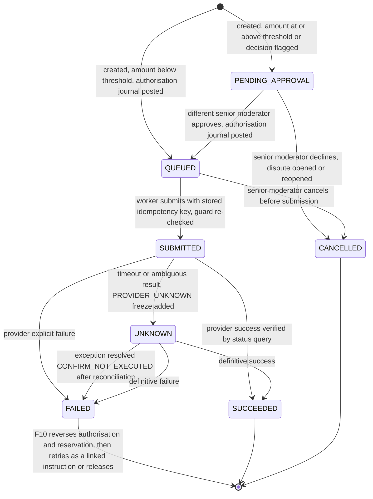

# Financial Engine

How money is allocated, journalled, released, refunded, retried and reconciled. The backend financial module is the only component that can create payout or refund instructions, and only as a consequence of a state transition defined in the [State Machine](TRANSACTION_STATE_MACHINE.md).

## 1. Principles

1. Financial safety first. Never release or refund on an unverified frontend action.
2. Backend authority. Moderators and users express intents; the financial module executes through the payment adapter after required approvals.
3. Immutable history. Ledger rows are append-only. Corrections are compensating journals linked by `reverses_entry_id`.
4. Idempotency. Every instruction has an idempotency key derived from stable ids. Resubmitting the same instruction reuses it; a retry after a confirmed failure is a new linked instruction with a new key.
5. No guessing. Any provider result that is not an explicit success or failure is `UNKNOWN` and freezes the affected lots.
6. Quantity-level money. Every cent belongs to a lot (a quantity of a line item); transaction totals are derived.
7. A deadline expiry never creates an instruction. Only confirmed acceptance, confirmed return receipt or a recorded moderator decision does.
8. Freeze protects disputed money. A frozen lot accepts no instruction except the one that executes an approved decision of the very dispute that froze it ([section 4](#4-instructions-freeze-and-approval)).
9. No chosen amounts. For quantity-based `RELEASE` and `REFUND` the instruction amount is computed from the lot allocation. Partial-price adjustment is not supported ([OD-14](../06-delivery/OPEN_DECISIONS.md)).
10. Approval before authorisation. An instruction at or above the high-value threshold is `PENDING_APPROVAL` and posts no ledger entry until a different senior moderator approves it.

## 2. Ledger accounts and journals

| Account | Meaning |
|---|---|
| `PROVIDER_CLEARING` | Money held at the provider for SupplyKey; debited on receipt, credited when a payout or refund is sent |
| `RECEIVED_UNSECURED` | Money collected but not yet confirmed as secured |
| `HELD_FUNDS` | Secured funds, per lot |
| `SUPPLIER_PAYABLE` | Funds authorised for release to the supplier |
| `BUYER_REFUNDABLE` | Funds authorised for refund to the buyer |
| `UNALLOCATED_OVERPAYMENT` | Duplicate or excess collections awaiting a manual decision |
| `PLATFORM_FEE_REVENUE`, `PROVIDER_FEES` | Fees; amounts are open ([OD-05, OD-06](../06-delivery/OPEN_DECISIONS.md)) and post only once decided |

| Event | Entry type | Debit | Credit |
|---|---|---|---|
| Collection verified (P2) | `PAYMENT_RECEIVED` | `PROVIDER_CLEARING` | `RECEIVED_UNSECURED` |
| Hold verified, funds secured (P3) | `FUNDS_SECURED` | `RECEIVED_UNSECURED` | `HELD_FUNDS`, per lot |
| Payout instruction becomes `QUEUED` (F1, F2) | `RELEASE_AUTHORIZED` | `HELD_FUNDS` | `SUPPLIER_PAYABLE` |
| Refund instruction becomes `QUEUED` (F1, F2) | `REFUND_AUTHORIZED` | `HELD_FUNDS` | `BUYER_REFUNDABLE` |
| Payout succeeded (F4) | `PAYOUT_SENT` | `SUPPLIER_PAYABLE` | `PROVIDER_CLEARING` |
| Refund succeeded (F4) | `REFUND_SENT` | `BUYER_REFUNDABLE` | `PROVIDER_CLEARING` |
| Authorisation released after a human decision (F8, F10) | `REVERSAL` | `SUPPLIER_PAYABLE` or `BUYER_REFUNDABLE` | `HELD_FUNDS` |
| Duplicate collection (P9) | `PAYMENT_RECEIVED` | `PROVIDER_CLEARING` | `UNALLOCATED_OVERPAYMENT` |
| Correction | `ADJUSTMENT` | as needed, linked to the original | as needed |

Each journal shares a `journal_id`, carries `transaction_id`, `item_id` and `lot_id`, and balances to zero (database trigger). Ledger rows are append-only.

A reservation is the lot's `pending_payout_kobo` or `pending_refund_kobo`, kept in step with the instruction items in the same transaction. It exists from instruction creation (including `PENDING_APPROVAL`, which has no ledger entry) until the instruction succeeds, is cancelled, or is released (F10).

## 3. Allocation

Every lot has an `item_quantity_allocations` row. Gross is exact: `quantity * unit_price_kobo`. Delivery and platform fees are apportioned in integer kobo with a deterministic rule so that no kobo is lost or created.

*Step 1: fee across lines.* For fee `F` and lines with totals `L_i` and goods total `G`: `base_i = floor(F * L_i / G)`; hand out the remaining `F - sum(base_i)` kobo one each to the lines with the largest remainder `(F * L_i) mod G`, ties to the lower `line_no`. Result: `f_i`.

*Step 2: line fee across units.* For a line with quantity `N` and line fee `f_i`, the share of units `a..b` is `floor(f_i * b / N) - floor(f_i * (a - 1) / N)`. Splitting a lot into contiguous ranges therefore always sums back exactly to the original.

Example: fee ₦100 = `10000` kobo on a 3-unit line. Units 1-2 get `6666`, unit 3 gets `3334`; total `10000`.

*What happens to fee shares on release or refund is OPEN* ([OD-05](../06-delivery/OPEN_DECISIONS.md)). The engine reads `delivery_fee_refund_policy` from configuration and refuses to create a refund instruction in production if it is unset. Demo seed data sets it explicitly and labels it `DEMO_ONLY`. Until decided, worked examples below use zero fees.

## 4. Instructions, freeze and approval

### 4.1 Amount rule (enforceable)

`instruction_amount(lot)` is computed only by the backend:

- With zero fee shares (MVP default): `instruction_amount = gross_amount_kobo = quantity * unit_price_kobo` of the lot, for both `RELEASE` and `REFUND`.
- With non-zero delivery or platform fee shares, the amount for `RELEASE` and for `REFUND` follows the configured fee policy (`delivery_fee_refund_policy` and the supplier share rule, [OD-05](../06-delivery/OPEN_DECISIONS.md)), which must split the whole lot allocation between supplier and buyer. If the policy is unset in production, creation is refused.

Consequences: a moderator or client cannot name an amount for quantity-based `RELEASE` or `REFUND`; a supplied `amount_kobo` must equal the computed value or the request fails with `422 AMOUNT_MUST_MATCH_ALLOCATION`; `decision_outcomes.amount_kobo` stores the computed value and a database trigger rejects any other; `payout_items` and `refund_items` have the same trigger. Amount-level settlement of a single unit (price reduction, partial compensation) is not supported and would need an explicitly approved adjustment mechanism with its own outcome, money status and tests ([OD-14](../06-delivery/OPEN_DECISIONS.md)). A decision over part of a lot first splits the lot by quantity.

### 4.2 Instruction creation

| Instruction | Created by | Idempotency key | Amount |
|---|---|---|---|
| Payout | L7 (acceptance confirmation) or L17 (dispute `RELEASE`) | `payout:{transaction_id}:{origin_id}:{action_seq}` | `instruction_amount` summed over the lots of the action |
| Refund | L10 (supplier-confirmed return) or L18 (dispute `REFUND`) | `refund:{transaction_id}:{origin_id}:{action_seq}` | Same |

Rules:

- Created only inside the transition transaction, never from a controller, and only through the creation guard in [State Machine 4.8](TRANSACTION_STATE_MACHINE.md#48-payout-and-refund-instructions-f).
- `origin_type` and `origin_id` are mandatory: `ACCEPTANCE_CONFIRMATION`, `RETURN_RECEIPT_CONFIRMATION` or `DISPUTE_DECISION`.
- One payout and at most one refund per approving action, covering all its lots, so a threshold cannot be avoided by splitting.
- Partial unique indexes on `payout_items(lot_id)` and `refund_items(lot_id)` for non-terminal or `SUCCEEDED` parents, plus the cross-table trigger, make a second or conflicting instruction impossible.
- The outbox worker submits `QUEUED` instructions using the stored key as the provider reference, then verifies by status query before `SUCCEEDED`. A global kill switch keeps instructions `QUEUED`.

### 4.3 Freeze and authorisation

The rule is defined once in [State Machine 2.4](TRANSACTION_STATE_MACHINE.md#24-lot-money-status-and-freezes). In short, a lot frozen by a dispute accepts only the instruction that executes an approved decision of that dispute (recorded after the evidence window, amount computed). A `PROVIDER_UNKNOWN` or `RECONCILIATION` freeze blocks creation and submission with no exception. The dispute freeze stays until the instruction succeeds, so unrelated instructions on disputed quantities remain impossible while the approved one executes.

### 4.4 Approval threshold

- An instruction is `PENDING_APPROVAL` when `amount_kobo >= high_value_threshold_kobo` (`50000000` kobo, ₦500,000, PROPOSED, [OD-07](../06-delivery/OPEN_DECISIONS.md)) or the decision has an acknowledged suspicious-evidence flag. Exactly at the threshold requires approval; one kobo below does not.
- The approver must be a `SENIOR_MODERATOR` and different from the moderator who made the decision (`SELF_APPROVAL_NOT_ALLOWED`). For a return refund with no moderator decision, any senior moderator may approve.
- No ledger entry is posted while an instruction is `PENDING_APPROVAL`. The authorisation journal posts when it becomes `QUEUED`. A declined approval cancels the instruction, releases the reservation and opens or reopens a dispute ([State Machine F9, L22](TRANSACTION_STATE_MACHINE.md#48-payout-and-refund-instructions-f)).

*Diagram source: [`INSTRUCTION_LIFECYCLE.mmd`](../diagrams/INSTRUCTION_LIFECYCLE.mmd)*

## 5. Failure and recovery

| Provider response | Instruction | Lot | Action |
|---|---|---|---|
| Success, verified by status query | `SUCCEEDED` | `SETTLED_RELEASED` or `SETTLED_REFUNDED` | Post the sent journal; release the dispute freeze; notify |
| Explicit failure | `FAILED` | Unchanged, reservation kept | Financial exception opens; a senior moderator retries or releases (below) |
| Timeout, 5xx after submit, malformed or ambiguous | `UNKNOWN` | `PROVIDER_UNKNOWN` freeze added | No retry, no new instruction. The resolver queries with the original reference |
| Provider unavailable before submit | `QUEUED` | Unchanged | Backoff retry |
| Duplicate webhook | Unchanged | Unchanged | `200`, no effect |

*Failed instructions.* A senior moderator resolves the exception in one of two ways. Both first reverse the old authorisation journal, if one exists, and release the old reservation. *Retry* then creates a new instruction linked by `retry_of_id`, with a new idempotency key, the same origin, lots, amount and destination snapshot, and the same creation guard and approval rules. If a dispute freeze exists, the retry must execute the decision of that same dispute. *Release* returns the lot's money status to `HELD` and opens or reopens a dispute for the quantity (reason `OTHER`). A retry is allowed only after a definitive provider failure or a reconciled `CONFIRM_NOT_EXECUTED`; it is never allowed while the outcome is `UNKNOWN` or a provider-unknown/reconciliation freeze remains.

*Unknown outcomes.* The resolver keeps querying the provider. It moves the instruction to `SUCCEEDED` or `FAILED` only on a definitive provider answer. If the settlement report shows no provider record after the expected lag, a senior moderator may resolve the reconciliation exception with `CONFIRM_NOT_EXECUTED`, recording the report as evidence; that sets `FAILED` and the retry or release rules above then apply. Reconciliation is therefore always required before an unknown outcome can be retried.

## 6. Reconciliation

Daily (and on demand): pull the provider settlement report through the adapter and match every provider record to a ledger journal by reference and amount. Exceptions: provider record without ledger entry; ledger entry without provider record after the expected lag (VERIFY); amount mismatch; duplicate provider reference. Each exception is assigned to a senior moderator, freezes the affected lots, and is resolved only with a documented compensating entry. Nightly invariant checks also recompute `released_kobo` and `refunded_kobo` from the ledger and compare them with the materialised allocation columns.

## 7. Worked example: five phones, accept 3, reject 2

Ibrahim Traders sells 5 × Samsung Galaxy A15 at ₦220,000 (`22000000` kobo each) to Chinedu Okafor. Fees are zero for this example. Total `110000000` kobo (₦1,100,000). Threshold: `50000000` kobo (₦500,000). The payout of ₦660,000 is above the threshold, so it needs a second approval. The refund of ₦440,000 is below it and goes straight to `QUEUED`.

| Step | Event | Lots (units: status, money) | Instruction | Journal |
|---|---|---|---|---|
| 1 | Collection verified, then hold verified | 1-5: `AWAITING_DISPATCH`, `HELD`, allocated `110000000` | | J1 Dr `PROVIDER_CLEARING` / Cr `RECEIVED_UNSECURED` `110000000`; J2 Dr `RECEIVED_UNSECURED` / Cr `HELD_FUNDS` `110000000` |
| 2 | Supplier dispatches all 5 within 72h; supplier photo requirement created | 1-5: `DISPATCHED` | | none |
| 3 | Buyer confirms receipt of 5; both parties submit delivery photographs | 1-5: `RECEIPT_CONFIRMED` | | none |
| 4 | Buyer accepts 3 (photos), rejects 2 (cites `SPEC_MATCH`) | 1-3: `SUBMITTED_FOR_REVIEW`, `HELD`. 4-5: `REJECTED_AWAITING_RETURN`, `HELD` | | none; evidence window opens (OD-02 proposed default: 48h) |
| 5 | Window closes. Moderator A confirms the accepted lot | 1-3: `ACCEPTED_CONFIRMED`, `RELEASE_PENDING` | Payout `PENDING_APPROVAL`, `66000000` kobo | none (not authorised) |
| 6 | Senior moderator B, a different person, approves | unchanged | Payout `QUEUED` | J3 Dr `HELD_FUNDS` / Cr `SUPPLIER_PAYABLE` `66000000` |
| 7 | Worker submits with the stored key | | Payout `SUBMITTED` | none |
| 8 | Provider success verified by status query | 1-3: `SETTLED_RELEASED`, `RELEASED` | Payout `SUCCEEDED` | J4 Dr `SUPPLIER_PAYABLE` / Cr `PROVIDER_CLEARING` `66000000` |
| 9 | Buyer hands 2 phones to a courier and submits evidence; 72h timer starts | 4-5: `RETURN_HANDOVER_RECORDED` | | none |
| 10 | Supplier confirms receipt of 2 | 4-5: `RETURN_RECEIPT_CONFIRMED`, `REFUND_PENDING` | Refund `QUEUED` at once, `44000000` kobo (below threshold) | J5 Dr `HELD_FUNDS` / Cr `BUYER_REFUNDABLE` `44000000` |
| 11 | Refund submitted; provider success verified | 4-5: `SETTLED_REFUNDED`, `REFUNDED` | Refund `SUCCEEDED` | J6 Dr `BUYER_REFUNDABLE` / Cr `PROVIDER_CLEARING` `44000000` |

Result: `66000000 + 44000000 = 110000000`; `HELD_FUNDS` is zero; transaction `COMPLETED`.

*Variant: partial return confirmation.* If in step 10 the supplier confirms only 1 of 2, only unit 4 gets a refund of `22000000` kobo (below threshold, `QUEUED`); unit 5 stays `RETURN_HANDOVER_RECORDED` with the original timer and becomes `IN_DISPUTE` when the 72 hours elapse. No refund is issued for unit 5 automatically.

*Variant: moderator-ordered refund on a frozen lot.* The supplier never dispatched units 4 and 5. At 72h a `NO_DISPATCH` dispute opens and both lots get a `DISPUTE` freeze. After the window closes the moderator records a `REFUND` outcome for the two units. The backend computes `44000000` kobo from the allocation (the moderator cannot type an amount) and creates the refund through the authorised exception: it is below the threshold, so `QUEUED` and the refund journal posts. The lots stay `IN_DISPUTE`, frozen and `REFUND_PENDING`; any attempt to create an unrelated payout or refund for them returns `409 LOT_FROZEN`. On provider success they become `SETTLED_REFUNDED` and the freeze is released. If the same decision covered all 5 units (`110000000` kobo, above the threshold) the refund would be `PENDING_APPROVAL`, the dispute `AWAITING_SECOND_APPROVAL`, and nothing would post until a different senior moderator approves.

*Boundary check.* `49999999` kobo is `QUEUED` directly; `50000000` kobo is `PENDING_APPROVAL`.

## 8. Invariants checked after every integration and end-to-end test

1. Every journal sums to zero.
2. `HELD_FUNDS` per transaction equals the sum of lot balances not yet authorised.
3. No lot has both a payout and a refund.
4. Paid out plus refunded never exceeds total received.
5. No ledger or audit row has been altered.
6. Each instruction has exactly one idempotency key and at most one provider reference.
7. No instruction on a frozen lot exists except one whose `origin_type = DISPUTE_DECISION` belongs to that lot's freezing dispute.
8. Every `RELEASE` or `REFUND` amount equals the computed lot allocation amount.
9. Every instruction at or above the threshold (or flagged) has an approval by a different senior moderator before its ledger authorisation journal exists.
10. A `PENDING_APPROVAL` instruction has no ledger entries.

## 9. Financial path of every transition

Every transition has a defined financial effect: either none, or a path through the guard, approval rule and ledger journals above.

| Transitions | Financial path |
|---|---|
| T1 to T3, T5 to T7 | None. T5 requires every lot settled |
| P1, P4, P5, P8 | None |
| P2 | `PAYMENT_RECEIVED` journal |
| P3, T4 | `FUNDS_SECURED` journal |
| P6, P7, P9 | Freeze; P9 books `UNALLOCATED_OVERPAYMENT`; resolution by compensating entries only |
| L1 to L6, L9, L12 to L16, L19, L20 | None. Expiry, dispatch, receipt, acceptance submission, rejection, return handover, contest and freeze-release transitions never create instructions or ledger entries |
| L7, L10, L17, L18, L21 | Instruction via the creation guard, `PENDING_APPROVAL` or `QUEUED`; authorisation journal when `QUEUED` |
| L22 | Instruction `CANCELLED`; no ledger entry existed; reservation released |
| L8, L11 | Via F4: sent journal after provider success |
| A1 to A5 | None until L7 |
| R1 to R5, D1 to D6, D10, W1 to W4, DP1 to DP5 | None |
| D7, D8, D9 | Create, approve or cancel instructions per F1, F2, F9 |
| F1 to F10 | As described in [State Machine 4.8](TRANSACTION_STATE_MACHINE.md#48-payout-and-refund-instructions-f) |

## 10. Related documents

[State Machine](TRANSACTION_STATE_MACHINE.md) · [Database 9](DATABASE_SPECIFICATION.md#9-payments-ledger-and-instructions) · [Payment Provider Integration](../04-operations/PAYMENT_PROVIDER_INTEGRATION.md) · [Dispute and Moderation](../04-operations/DISPUTE_AND_MODERATION.md)
