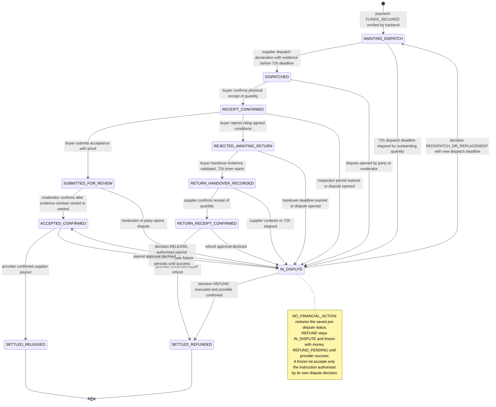
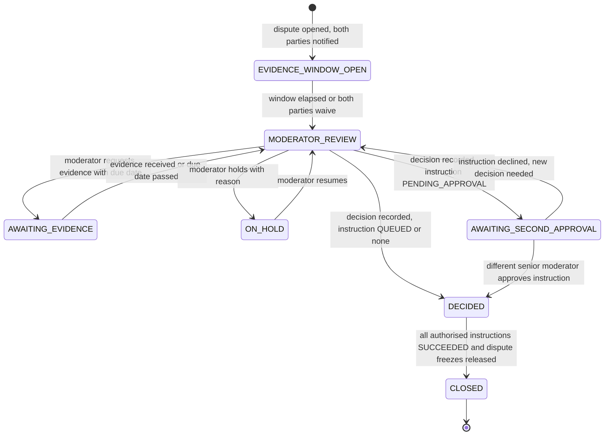
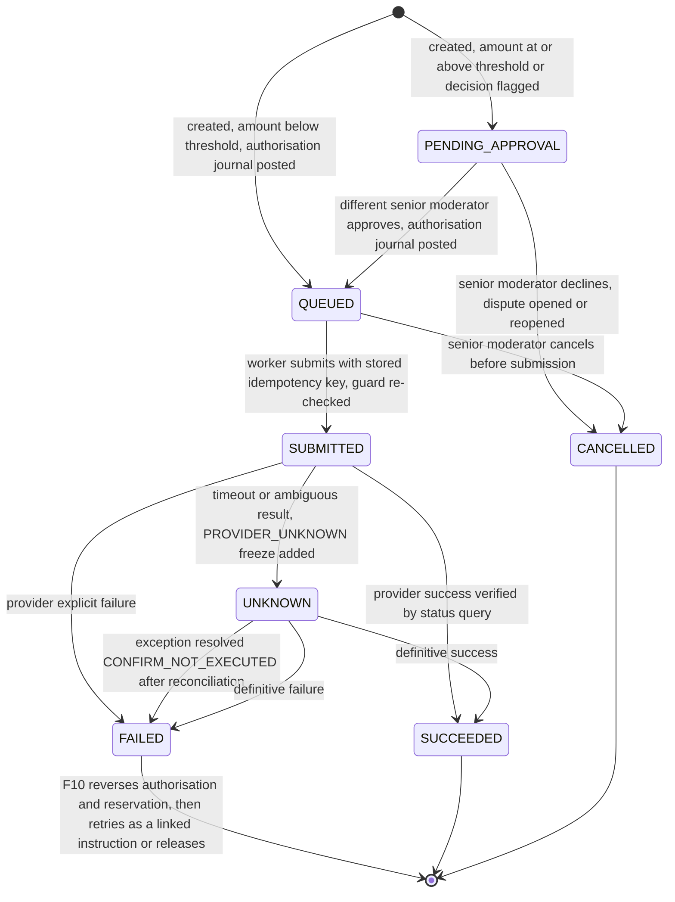
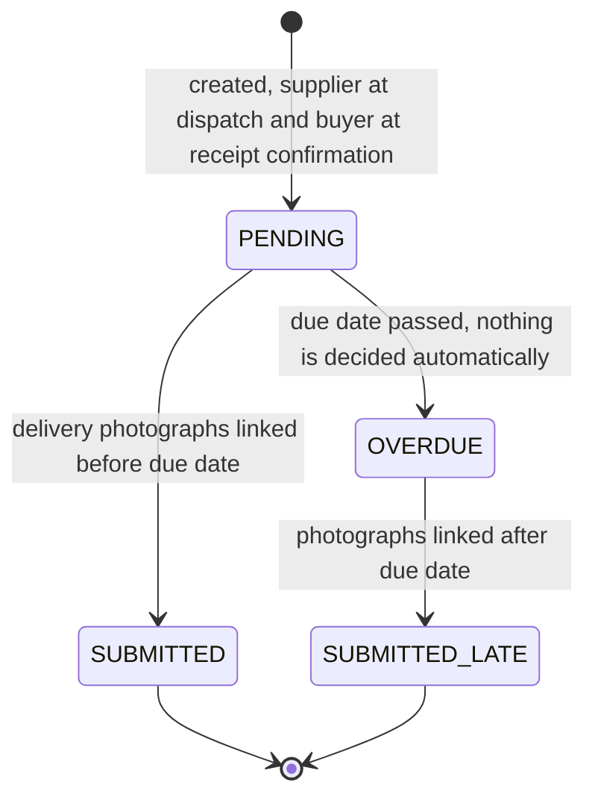

# Transaction State Machine

The single definition of every status name and every legal transition. Database, API, frontend types, diagrams and tests all use the enums in section 2 exactly. Several related state machines are used instead of one giant status field.

## 1. Principles

1. Every transition is a named backend function `transition(machine, entity, event, actor)`. Inside one database transaction it locks the aggregate row, checks preconditions, writes the new state, ledger rows (if any), the audit row and outbox rows. Nothing external is called inside that transaction.
2. Illegal transitions return `409 INVALID_STATE_TRANSITION` and write nothing.
3. A frontend action is an intent, never authority to move money.
4. All deadlines are computed on the server in UTC from config values snapshotted at funding.
5. No UNKNOWN or ambiguous financial state ever triggers an automatic payout or refund.
6. Deadline expiry opens a dispute or a moderator review. It never creates a payout or refund.
7. Partial quantities are first-class: statuses apply to lots (quantities of a line item), see [Database 5](DATABASE_SPECIFICATION.md#5-quantity-model).
8. Freeze protects disputed money; authorisation is the only way through it. A frozen lot accepts no new financial instruction, with exactly one exception: the instruction that executes an approved moderator decision made in the very dispute that froze the lot (section 4.8). Everything else against a frozen lot is refused (`409 LOT_FROZEN`).
9. Instruction amounts are never chosen by a moderator or client. For quantity-based `RELEASE` and `REFUND` the backend computes the amount from the lot's allocation (section 4.8).

## 2. Canonical enums

This is the only place status names are defined. If a name is not here it is not allowed anywhere else.

### 2.1 Transaction (`transactions.status`)

| Value | Meaning |
|---|---|
| `DRAFT` | Supplier is composing terms. |
| `AWAITING_BUYER_AGREEMENT` | Sent to buyer; waiting for the buyer to agree to the current agreement version. |
| `AWAITING_PAYMENT` | Buyer agreed; payment not yet funded. |
| `FUNDED` | Backend verified that funds are secured by the approved arrangement. Fulfilment progress is read from lots. |
| `COMPLETED` | Every lot is `SETTLED_RELEASED` or `SETTLED_REFUNDED`. |
| `CANCELLED` | Cancelled before funding. |
| `EXPIRED` | Invitation or payment window elapsed before funding. |

`has_open_dispute` is a derived boolean on transaction responses, not a status.

### 2.2 Payment (`payments.status`)

| Value | Meaning |
|---|---|
| `PENDING` | Attempt created; awaiting provider outcome. |
| `PAYMENT_RECEIVED` | Provider verified collection of the money. Not yet proof that funds are held. |
| `FUNDS_SECURED` | Provider verified that the money is held under the approved arrangement. Only this value can make a transaction `FUNDED`. |
| `FAILED` | Provider explicitly reported failure. |
| `EXPIRED` | Attempt expired with no success. |
| `UNKNOWN` | Timeout or ambiguous provider result. Money frozen until resolved. |

### 2.3 Item lot status

| Value | Meaning |
|---|---|
| `AWAITING_DISPATCH` | Funds secured; this quantity has not been dispatched. |
| `DISPATCHED` | Supplier declared dispatch with evidence; not independently verified. |
| `RECEIPT_CONFIRMED` | Buyer explicitly confirmed physical receipt. Separate from photo upload. |
| `SUBMITTED_FOR_REVIEW` | Buyer submitted acceptance with proof; awaiting evidence window and moderator review. |
| `ACCEPTED_CONFIRMED` | Moderator confirmed acceptance (or a dispute decision released it). Eligible for payout. |
| `REJECTED_AWAITING_RETURN` | Buyer rejected against agreed conditions; funds remain held. |
| `RETURN_HANDOVER_RECORDED` | Buyer uploaded validated handover evidence; 72-hour supplier timer running. |
| `RETURN_RECEIPT_CONFIRMED` | Supplier confirmed receipt of this quantity; refund may proceed. |
| `IN_DISPUTE` | Quantity frozen pending a moderator decision (and, for a REFUND decision, until execution). |
| `SETTLED_RELEASED` | Provider-confirmed supplier payout completed. |
| `SETTLED_REFUNDED` | Provider-confirmed buyer refund completed. |

Not allowed anywhere: `UNDER_REVIEW` (renamed `MODERATOR_REVIEW` and used only as a dispute status), `SUBMITTED` (alone), `ACCEPTANCE_UNDER_REVIEW`, `DELIVERED_PENDING_DECISION`, `FUNDED_AWAITING_DISPATCH`.

### 2.4 Lot money status and freezes

| Value | Meaning |
|---|---|
| `HELD` | Funds held; no instruction reserves them. |
| `RELEASE_PENDING` | A payout instruction exists for this lot (`PENDING_APPROVAL`, `QUEUED`, `SUBMITTED` or `UNKNOWN`). The allocation is reserved. |
| `RELEASED` | Payout succeeded. |
| `REFUND_PENDING` | A refund instruction exists for this lot (same non-terminal statuses). The allocation is reserved. |
| `REFUNDED` | Refund succeeded. |

*Freezes.* A lot can carry one or more active rows in `lot_freezes`, each with a reason: `DISPUTE` (with `dispute_id`), `PROVIDER_UNKNOWN` (with `instruction_id`) or `RECONCILIATION`. `item_quantity_lots.is_frozen` is true while any active freeze exists.

Instruction rule for frozen lots (single source, used by every document):

| Lot situation | May a new instruction be created? |
|---|---|
| Not frozen | Yes, only by L7 (acceptance confirmation) or L10 (supplier-confirmed return refund), and only if no other non-terminal instruction exists for the lot |
| Frozen only by `DISPUTE` freezes, and the creating transition is L17 or L18 of the same dispute (`frozen_by` dispute = the decision's dispute), the decision is recorded after the evidence window closed or was waived, and the amount equals the lot allocation | Yes (the authorised exception). The freeze is not lifted by creating the instruction |
| A definitively `FAILED` instruction is being retried through F10 | Yes, only after its authorisation journal is reversed and its reservation released; the new instruction must retain the same origin, lots, amount and destination snapshot, link to the failed instruction, and pass the creation guard and approval rules again. If a dispute freeze exists, the origin must be the decision of that same dispute |
| Frozen by `DISPUTE` and anything else (another dispute, an unrelated payout or ordinary refund) | No: `409 LOT_FROZEN` |
| Frozen by `PROVIDER_UNKNOWN` or `RECONCILIATION` (alone or together with `DISPUTE`) | No, no exception. A retry remains blocked until the outcome is definitively resolved |

The dispute freeze persists while the authorised instruction is `PENDING_APPROVAL`, `QUEUED`, `SUBMITTED`, `UNKNOWN` or `FAILED`, so unrelated instructions remain impossible. A definitively failed instruction may be retried only through F10: reverse its authorisation journal, release its reservation, then create a linked instruction for the same decision and lots. The dispute freeze remains in place during this operation. It is released only when the instruction reaches `SUCCEEDED` (the lot settles) or when a later decision (`NO_FINANCIAL_ACTION`, `REDISPATCH_OR_REPLACEMENT`) releases it. A `CANCELLED` instruction leaves the freeze in place.

### 2.5 Acceptance review decision (`item_quantity_decisions.review_status`)

| Value | Meaning |
|---|---|
| `SUBMITTED_FOR_REVIEW` | Acceptance submitted with proof; evidence window running or ready for moderator. |
| `EVIDENCE_REQUESTED` | Moderator asked a party for more evidence; decision blocked until due date or response. |
| `CONFIRMED` | Moderator confirmed. |
| `DISPUTED` | Moderator or a party converted it to a dispute. |

`review_status` is NULL on a decision with `quantity_accepted = 0` (pure rejection).

### 2.6 Evidence window (`evidence_windows.status`) and requests

| Value | Meaning |
|---|---|
| `OPEN` | Both parties may add evidence. |
| `CLOSED_ELAPSED` | `ends_at` passed. |
| `CLOSED_WAIVED` | Both parties explicitly waived. |

`evidence_requests.status`: `OPEN`, `FULFILLED`, `EXPIRED`.

### 2.7 Return (`returns.status`)

| Value | Meaning |
|---|---|
| `AWAITING_HANDOVER_EVIDENCE` | Return record opened; no timer. |
| `HANDOVER_RECORDED` | Validated handover evidence uploaded; 72-hour timer running. |
| `RECEIPT_CONFIRMED` | Supplier confirmed all returned quantity. |
| `IN_DISPUTE` | At least one returned quantity is in dispute. |
| `CLOSED` | All returned quantity settled. |

### 2.8 Dispute (`disputes.status`)

`EVIDENCE_WINDOW_OPEN`, `MODERATOR_REVIEW`, `AWAITING_EVIDENCE`, `ON_HOLD`, `AWAITING_SECOND_APPROVAL`, `DECIDED`, `CLOSED`.

`MODERATOR_REVIEW` means the evidence window is closed and a moderator is assessing the case. This status is used only for disputes; item review and decision review use their own statuses.

`disputes.reason_code`: `NO_DISPATCH`, `RETURN_NOT_CONFIRMED`, `RETURN_CONTESTED`, `ACCEPTANCE_DISAGREEMENT`, `SPEC_DISAGREEMENT`, `DELIVERY_DISAGREEMENT`, `SUSPICIOUS_EVIDENCE`, `INSPECTION_PERIOD_EXPIRED` (PROPOSED), `RETURN_HANDOVER_OVERDUE` (PROPOSED), `OTHER`.
`disputes.origin`: `AUTO`, `BUYER`, `SUPPLIER`, `MODERATOR`.
Decision outcomes (per lot and quantity): `RELEASE`, `REFUND`, `REDISPATCH_OR_REPLACEMENT`, `NO_FINANCIAL_ACTION`. Partial settlement is expressed as a decision with `RELEASE` and `REFUND` lines over different quantities of the same item. There is no separate `SPLIT` outcome or amount-level split ([OD-14](../06-delivery/OPEN_DECISIONS.md)).

### 2.9 Payout and refund (`payouts.status`, `refunds.status`)

`PENDING_APPROVAL`, `QUEUED`, `SUBMITTED`, `SUCCEEDED`, `FAILED`, `UNKNOWN`, `CANCELLED`.

### 2.10 Other enums

| Enum | Values |
|---|---|
| Roles (`users.role`) | `USER`, `MODERATOR`, `SENIOR_MODERATOR`, `ADMIN` |
| Party (`party_role`) | `BUYER`, `SUPPLIER`, `MODERATOR` |
| Evidence purpose | `DISPATCH`, `DELIVERY_PHOTO`, `ACCEPTANCE_PROOF`, `REJECTION_PROOF`, `RETURN_HANDOVER`, `RETURN_RECEIPT`, `DISPUTE`, `EVIDENCE_REQUEST_RESPONSE`, `OTHER` |
| Return contest reason | `WRONG_ITEM`, `DAMAGED`, `QUANTITY_MISMATCH`, `NOT_RECEIVED` |
| Delivery-photo requirement (`delivery_photo_requirements.status`) | `PENDING`, `SUBMITTED`, `OVERDUE`, `SUBMITTED_LATE` |
| Freeze reason (`lot_freezes.reason`) | `DISPUTE`, `PROVIDER_UNKNOWN`, `RECONCILIATION`; a freeze is active while `released_at` is null |
| Evidence file (`evidence_files.status`) | `UPLOADING`, `VERIFIED`, `LINKED`, `RETIRED` |
| Financial exception (`financial_exceptions.status`) | `OPEN`, `RESOLVED` |
| Instruction origin (`origin_type`) | `ACCEPTANCE_CONFIRMATION`, `RETURN_RECEIPT_CONFIRMATION`, `DISPUTE_DECISION` |

## 3. Lifecycle diagram

*Diagram source: [`TRANSACTION_LIFECYCLE.mmd`](../diagrams/TRANSACTION_LIFECYCLE.mmd)*

## 4. Transitions

Columns: starting state, trigger, authorised actor, preconditions, new state, database and financial effects, notifications and deadlines, failure handling. Every change also writes an audit row and uses `Idempotency-Key` where it originates from an API call.

### 4.1 Payment (P)

| # | From | Trigger | Actor | Preconditions | To | Effects | Notify / deadline | Failure handling |
|---|---|---|---|---|---|---|---|---|
| P1 | none | Buyer starts payment | Buyer | Transaction `AWAITING_PAYMENT`; buyer agreed to current version; no active attempt | `PENDING` | Insert `payments`, `payment_attempts`; first attempt locks terms | Attempt expiry 30 min (PROPOSED) | Provider error: attempt `FAILED`; buyer may retry |
| P2 | `PENDING` | Verified webhook or resolver poll: collection succeeded | System | Signature valid, event new, independent status query confirms, amount, currency, reference match | `PAYMENT_RECEIVED` | Store provider event; ledger `PAYMENT_RECEIVED` journal | none | Query fails: `UNKNOWN` |
| P3 | `PAYMENT_RECEIVED` (when collection and hold are verified in one step, P2 is applied first) | Provider confirms funds secured | System | Adapter `getHoldStatus` confirms secured; adapter capability `supportsConditionalHolding` true; production funds enabled or provider is simulated | `FUNDS_SECURED` | Ledger `FUNDS_SECURED` journal (per lot); transaction `FUNDED`; `funded_at`; `dispatch_deadline_at = funded_at + 72h`; lots created `AWAITING_DISPATCH`; config snapshot | Notify both; reminders per [Notifications](../04-operations/NOTIFICATIONS_AND_DEADLINES.md) | Hold not confirmed: stays `PAYMENT_RECEIVED`, transaction stays `AWAITING_PAYMENT`, exception raised, supplier not told to dispatch |
| P4 | `PENDING` | Provider explicit failure | System | Verified failure | `FAILED` | Attempt failed; no ledger | Notify buyer | New attempt allowed |
| P5 | `PENDING` | Attempt expiry | System | Status query shows no success | `EXPIRED` | none | Notify buyer | New attempt allowed |
| P6 | `PENDING`, `PAYMENT_RECEIVED` | Timeout or ambiguous result | System | Result not explicit | `UNKNOWN` | Freeze; exception queue | Alert ops; tell buyer "being confirmed" | Resolver polls with backoff for 24h then manual exception. No new attempt with a new key, no assumption |
| P7 | `UNKNOWN` | Resolver gets a definitive result | System | Definitive provider status | `PAYMENT_RECEIVED` or `FAILED` or `EXPIRED` | Resume P3 or P4 | As above | Late success after cancellation: exception, manual refund via normal approval |
| P8 | any | Duplicate webhook | System | `(provider, event_id)` exists | unchanged | Note only | none | Return `200` |
| P9 | `FUNDS_SECURED` | Second successful collection for same transaction | System | | unchanged | Ledger `UNALLOCATED_OVERPAYMENT`; financial exception | Alert moderator | Manual refund via approval path |

### 4.2 Transaction (T)

| # | From | Trigger | Actor | Preconditions | To | Effects | Notify / deadline | Failure |
|---|---|---|---|---|---|---|---|---|
| T1 | `DRAFT` | Send | Supplier | At least one line item; payout account set; every line has at least one agreed condition | `AWAITING_BUYER_AGREEMENT` | Create agreement version, invitation | Notify buyer; invite expiry 7d (PROPOSED) | 422 validation |
| T2 | `AWAITING_BUYER_AGREEMENT` | Buyer agrees | Buyer | Version is current; hash matches | `AWAITING_PAYMENT` | `buyer_agreed_at`, hash, IP | Notify supplier | `AGREEMENT_VERSION_STALE` |
| T3 | `AWAITING_BUYER_AGREEMENT`, `AWAITING_PAYMENT` | Supplier edits terms | Supplier | No payment attempt exists | `AWAITING_BUYER_AGREEMENT` | New agreement version; buyer agreement voided | Notify buyer | After first attempt: `TERMS_LOCKED` |
| T4 | `AWAITING_PAYMENT` | P3 | System | See P3 | `FUNDED` | See P3 | See P3 | See P3 |
| T5 | `FUNDED` | Last lot settles | System | Every lot `SETTLED_RELEASED` or `SETTLED_REFUNDED` | `COMPLETED` | none | Notify both | Invariant failure: exception |
| T6 | `DRAFT`, `AWAITING_BUYER_AGREEMENT`, `AWAITING_PAYMENT` | Cancel | Supplier or buyer | No `PENDING`, `PAYMENT_RECEIVED`, `FUNDS_SECURED` or `UNKNOWN` payment (PROPOSED, [OD-09](../06-delivery/OPEN_DECISIONS.md)) | `CANCELLED` | none | Notify | |
| T7 | `AWAITING_BUYER_AGREEMENT`, `AWAITING_PAYMENT` | Window elapsed | System | | `EXPIRED` | none | Notify | |

Cancellation after funding is OPEN ([OD-09](../06-delivery/OPEN_DECISIONS.md)). Until decided, the only path is a manual dispute with a moderator decision.

### 4.3 Item lots (L)

A lot is a quantity of a line item. When an action covers part of a lot the backend splits the lot first (see [Database 5](DATABASE_SPECIFICATION.md#5-quantity-model)); all rules below apply to the lot being moved.

| # | From | Trigger | Actor | Preconditions | To | Effects (DB and financial) | Notify / deadline | Failure |
|---|---|---|---|---|---|---|---|---|
| L1 | (new) | P3 | System | | `AWAITING_DISPATCH`, money `HELD` | Lots created from line quantities; allocations computed; `lot_freezes` empty | | |
| L2 | `AWAITING_DISPATCH` | Dispatch declared | Supplier | Server time < `dispatch_deadline_at`; at least one `DISPATCH` evidence file; quantity <= lot quantity | `DISPATCHED` | `dispatch_declarations` and items; lot keeps `dispatch_id`; supplier delivery-photo requirement created (DP1); no ledger | Notify buyer; supplier is shown the photo due date | `DISPATCH_DEADLINE_PASSED` with `dispute_id` if past deadline |
| L3 | `AWAITING_DISPATCH` | Deadline elapsed | System scanner | `now >= dispatch_deadline_at`; lot still `AWAITING_DISPATCH` | `IN_DISPUTE` | `pre_dispute_status = AWAITING_DISPATCH`; freeze row `DISPUTE` added to `lot_freezes`; dispute `NO_DISPATCH` (one open per transaction, outstanding quantities added); window opens. No ledger entries | Notify both; evidence window uses OD-02 (proposed default 48h) | Scanner re-run is a no-op (unique index) |
| L4 | `DISPATCHED` | Buyer confirms receipt | Buyer | Quantity selected; <= dispatched lot quantity | `RECEIPT_CONFIRMED` | `receipt_confirmations`; lot keeps `receipt_confirmation_id`; buyer delivery-photo requirement created (DP2); `inspection_deadline_at = now + inspection_period` (PROPOSED); the supplier requirement's due date moves earlier if needed (DP1) | Notify supplier | A photograph alone never does this |
| L5 | `RECEIPT_CONFIRMED` | Buyer submits acceptance | Buyer | At least one proof file; accepted + rejected <= lot quantity; buyer delivery-photo requirement for this receipt is `SUBMITTED` or `SUBMITTED_LATE` | `SUBMITTED_FOR_REVIEW` | Decision row `review_status = SUBMITTED_FOR_REVIEW`; evidence window opens; no payout | Notify both parties; window 48h (PROPOSED) | `EVIDENCE_REQUIRED`, `DELIVERY_PHOTOS_REQUIRED` |
| L6 | `RECEIPT_CONFIRMED` | Buyer rejects | Buyer | At least one `agreed_condition_id` of the current agreement; evidence attached; buyer delivery-photo requirement `SUBMITTED` or `SUBMITTED_LATE` | `REJECTED_AWAITING_RETURN` | `rejection_conditions` rows; money stays `HELD`; no refund | Notify supplier; handover deadline 7d (PROPOSED) | `REJECTION_REASON_NOT_IN_AGREEMENT`, `DELIVERY_PHOTOS_REQUIRED` |
| L7 | `SUBMITTED_FOR_REVIEW` | Moderator confirms | Moderator (not a party) | Window `CLOSED_ELAPSED` or `CLOSED_WAIVED`; no `OPEN` evidence request; reason and evidence ids recorded; supplier delivery-photo requirement `SUBMITTED` or `SUBMITTED_LATE`, or `OVERDUE` with the moderator's recorded acknowledgement | `ACCEPTED_CONFIRMED` | Decision `CONFIRMED`; one payout instruction created for the lot(s) confirmed in this action with amount = allocation; lot money `RELEASE_PENDING`. Status `PENDING_APPROVAL` if amount >= threshold or the decision is flagged, else `QUEUED`; ledger journal posts when the instruction becomes `QUEUED` (F1, F2) | Notify both; senior moderators notified if approval needed | `EVIDENCE_WINDOW_OPEN`, `EVIDENCE_REQUEST_OPEN`, `SUPPLIER_DELIVERY_PHOTOS_PENDING`, `ACKNOWLEDGEMENT_REQUIRED` |
| L8 | `ACCEPTED_CONFIRMED` | Payout succeeded | System | Provider-confirmed | `SETTLED_RELEASED` | Money `RELEASED`; payout-sent journal | Notify supplier | Failure: see F |
| L9 | `REJECTED_AWAITING_RETURN` | Handover evidence validated and linked | Buyer | Return open; at least one handover photo; upload completed, hash verified | `RETURN_HANDOVER_RECORDED` | Return `HANDOVER_RECORDED`; `handover_evidence_uploaded_at = server time`; `confirmation_deadline_at = that + 72h`. Additional evidence never resets it | Notify supplier; reminders | `HANDOVER_ALREADY_SUBMITTED` |
| L10 | `RETURN_HANDOVER_RECORDED` | Supplier confirms quantity received | Supplier | Quantity <= handed over quantity not yet confirmed or contested; evidence attached; lot not frozen | `RETURN_RECEIPT_CONFIRMED` (that quantity only) | `quantity_received_confirmed` increases; one refund instruction created for the confirmed lot(s) with amount = allocation per fee policy; lot money `REFUND_PENDING`; `PENDING_APPROVAL` if amount >= threshold, else `QUEUED`; ledger journal posts at `QUEUED` | Notify buyer | Partial confirmation does not mark whole return confirmed |
| L11 | `RETURN_RECEIPT_CONFIRMED` | Refund succeeded | System | Provider-confirmed | `SETTLED_REFUNDED` | Money `REFUNDED`; refund-sent journal | Notify buyer | Failure: see F |
| L12 | `RETURN_HANDOVER_RECORDED` | Supplier contests | Supplier | Reason code, evidence | `IN_DISPUTE` | `quantity_contested` increases; dispute `RETURN_CONTESTED` immediately; frozen | Notify both | |
| L13 | `RETURN_HANDOVER_RECORDED` | 72h elapsed | System scanner | `now >= confirmation_deadline_at`; outstanding quantity > 0 | `IN_DISPUTE` | One dispute per return (`RETURN_NOT_CONFIRMED`); outstanding quantity added; no refund | Notify both; evidence window uses OD-02 (proposed default 48h) | Timer expiry does not assume supplier fault |
| L14 | `DISPATCHED`, `RECEIPT_CONFIRMED`, `SUBMITTED_FOR_REVIEW`, `REJECTED_AWAITING_RETURN` | Manual dispute opened | Buyer, supplier, moderator | Scoped quantities; no duplicate open dispute for same reason and quantities | `IN_DISPUTE` | `pre_dispute_status` saved; frozen | Notify both | `DISPUTE_ALREADY_OPEN` |
| L15 | `RECEIPT_CONFIRMED` | Inspection period elapsed | System scanner | PROPOSED rule; undecided quantity remains | `IN_DISPUTE` | Dispute `INSPECTION_PERIOD_EXPIRED`; never auto-accept or auto-refund | Notify both | |
| L16 | `REJECTED_AWAITING_RETURN` | Handover deadline elapsed | System scanner | PROPOSED rule; no handover evidence | `IN_DISPUTE` | Dispute `RETURN_HANDOVER_OVERDUE`; no refund | Notify both | |
| L17 | `IN_DISPUTE` | Decision `RELEASE` for the lot | Moderator records; system executes | Decision recorded after window closed or waived and no open request; lot frozen only by this dispute; outcome quantity equals the lot (sub-lot split first); amount = lot allocation | `ACCEPTED_CONFIRMED` | Payout instruction created through the authorised exception (`origin_type = DISPUTE_DECISION`); lot money `RELEASE_PENDING`; dispute freeze stays until payout `SUCCEEDED`; `PENDING_APPROVAL` if amount >= threshold or flagged, else `QUEUED` | Notify both | `LOT_FROZEN` if any other freeze or dispute applies |
| L18 | `IN_DISPUTE` | Decision `REFUND` for the lot | Moderator records; system executes | Same as L17 | stays `IN_DISPUTE`, money `REFUND_PENDING`, then `SETTLED_REFUNDED` | Refund instruction created through the authorised exception; dispute freeze stays until refund `SUCCEEDED`, so no unrelated instruction can touch the lot. See gap note below | Notify both | `LOT_FROZEN` as above |
| L19 | `IN_DISPUTE` | Decision `NO_FINANCIAL_ACTION` | System | Decision recorded after window | `pre_dispute_status` restored | Dispute freeze released; no instruction | Notify both | |
| L20 | `IN_DISPUTE` | Decision `REDISPATCH_OR_REPLACEMENT` | System | Both parties' consent statements recorded ([OD-10](../06-delivery/OPEN_DECISIONS.md)) | `AWAITING_DISPATCH` | New `dispatch_deadline_at` set by the decision; unfreeze | Notify both | |
| L21 | `IN_DISPUTE` | Mixed decision with partial release and refund | System | Lines for different quantities of one item: some `RELEASE`, some `REFUND`; lot split into sub-lots first; every line equals a whole sub-lot | per sub-lot | Sub-lots inherit the dispute freeze; each follows L17 or L18 with its own instruction | Notify both | Amount-level split of one unit is not supported ([OD-14](../06-delivery/OPEN_DECISIONS.md)); `AMOUNT_MUST_MATCH_ALLOCATION` |
| L22 | `ACCEPTED_CONFIRMED`, `RETURN_RECEIPT_CONFIRMED`, `IN_DISPUTE` | Approval of the lot's instruction declined | Senior moderator | Instruction `PENDING_APPROVAL`; reason recorded | `IN_DISPUTE` (for a dispute-origin instruction the lot never left it) | Instruction `CANCELLED`; money back to `HELD`; no ledger entry was posted; a dispute opens (`ACCEPTANCE_DISAGREEMENT` for a payout, `OTHER` for a return refund) or the origin dispute returns to `MODERATOR_REVIEW` | Notify both | A new decision supersedes the declined one |

*Gap note (flagged, not decided).* The item status enum has no separate `REFUND_AUTHORISED` value. For a dispute `REFUND` the lot therefore stays `IN_DISPUTE` with `money_status = REFUND_PENDING` and its dispute freeze until the provider confirms, then becomes `SETTLED_REFUNDED`. If the team prefers an extra enum value this must be approved and changed in every document together.

Every lot transition re-checks: `released + refunded + pending_payout + pending_refund <= allocated`, and that no instruction is created against a frozen lot except through the authorised exception in section 2.4.

### 4.4 Acceptance review decision (A)

| # | From | Trigger | Actor | Preconditions | To | Effects | Notify / deadline | Failure |
|---|---|---|---|---|---|---|---|---|
| A1 | none | `POST /transactions/{id}/decisions` with accepted quantity | Buyer | L5 preconditions | `SUBMITTED_FOR_REVIEW` | Decision row; evidence window (W1) | Both parties | |
| A2 | `SUBMITTED_FOR_REVIEW` | Moderator requests evidence | Moderator | Reason, party, question, `due_at` | `EVIDENCE_REQUESTED` | `evidence_requests` row `OPEN` | Notify requested party and the other | |
| A3 | `EVIDENCE_REQUESTED` | Evidence received or `due_at` passed | System / party | | `SUBMITTED_FOR_REVIEW` | Request `FULFILLED` or `EXPIRED` | Notify moderator | |
| A4 | `SUBMITTED_FOR_REVIEW` | Moderator confirms | Moderator | L7 preconditions | `CONFIRMED` | See L7 | | |
| A5 | `SUBMITTED_FOR_REVIEW`, `EVIDENCE_REQUESTED` | Moderator or party opens dispute | Moderator, buyer, supplier | Reason recorded | `DISPUTED` | Lots `IN_DISPUTE` (L14); dispute `ACCEPTANCE_DISAGREEMENT` | Both | |

### 4.5 Return (R)

| # | From | Trigger | Actor | Preconditions | To | Effects | Notify / deadline |
|---|---|---|---|---|---|---|---|
| R1 | none | Buyer opens return | Buyer | Lots `REJECTED_AWAITING_RETURN`; quantity not already returned or refunded | `AWAITING_HANDOVER_EVIDENCE` | `returns`, `return_items.quantity_returned`; no timer | Reminder if idle |
| R2 | `AWAITING_HANDOVER_EVIDENCE` | Handover evidence validated | Buyer | L9 | `HANDOVER_RECORDED` | Timer set | Notify supplier |
| R3 | `HANDOVER_RECORDED` | All returned quantity confirmed | Supplier | Every unit confirmed | `RECEIPT_CONFIRMED` | Refunds created per L10 | Notify buyer |
| R4 | `HANDOVER_RECORDED` | Contest or 72h expiry | Supplier / system | L12, L13 | `IN_DISPUTE` | One dispute per return; other quantity may still be confirmed | Notify both |
| R5 | `RECEIPT_CONFIRMED`, `IN_DISPUTE` | All quantity settled | System | | `CLOSED` | | |

### 4.6 Dispute (D)

| # | From | Trigger | Actor | Preconditions | To | Effects | Notify / deadline | Failure |
|---|---|---|---|---|---|---|---|---|
| D1 | none | Auto or manual open | System, party, moderator | No duplicate open dispute for same reason and quantities | `EVIDENCE_WINDOW_OPEN` | Window W1 `ends_at` is computed from the configured OD-02 duration (proposed default 48h); lots frozen | Both parties, immediately, with affected quantities, funds status and deadline | `DISPUTE_ALREADY_OPEN` |
| D2 | `EVIDENCE_WINDOW_OPEN` | Window elapsed or both waive | System / parties | | `MODERATOR_REVIEW` | Window closed | Notify moderator queue | |
| D3 | `MODERATOR_REVIEW` | Request evidence | Moderator | | `AWAITING_EVIDENCE` | Request `OPEN` with `due_at` | Notify named party and the other | |
| D4 | `AWAITING_EVIDENCE` | Evidence received or due date passed | System | | `MODERATOR_REVIEW` | Request closed | | |
| D5 | `MODERATOR_REVIEW` | Hold | Moderator | Reason | `ON_HOLD` | Audit | Reminder every 48h (PROPOSED) | |
| D6 | `ON_HOLD` | Resume | Moderator | | `MODERATOR_REVIEW` | | | |
| D7 | `MODERATOR_REVIEW` | Record decision | Moderator (not a party) | Window closed or waived; no open request; per-quantity outcomes whose quantities equal whole lots; reason of at least 50 characters; evidence ids; every `RELEASE` and `REFUND` amount equals the lot allocation (server-computed) | `AWAITING_SECOND_APPROVAL` if any created instruction is `PENDING_APPROVAL`, else `DECIDED` | `moderator_decisions` and `decision_outcomes` rows; instructions created through the authorised exception (F1): `PENDING_APPROVAL` when the instruction amount is at or above the threshold or the decision is flagged, else `QUEUED`; a `NO_FINANCIAL_ACTION`-only decision creates none | Notify both; senior moderators if approval needed | `EVIDENCE_WINDOW_OPEN`, `AMOUNT_MUST_MATCH_ALLOCATION`, `LOT_FROZEN` |
| D8 | `AWAITING_SECOND_APPROVAL` | Approve the last pending instruction of the decision | Senior moderator, different person | Approver is `SENIOR_MODERATOR` and not the deciding moderator | `DECIDED` | Instruction `QUEUED` and its ledger journal posted (F2) | Notify both | `SELF_APPROVAL_NOT_ALLOWED` |
| D9 | `AWAITING_SECOND_APPROVAL` | Decline an instruction of the decision | Senior moderator | Reason recorded | `MODERATOR_REVIEW` | Instruction `CANCELLED`; no ledger entry existed; original decision preserved; dispute freeze stays; a new decision supersedes | Notify moderator | |
| D10 | `DECIDED` | All instructions terminal | System | | `CLOSED` | | Notify both with decision and reason | |

*Diagram source: [`DISPUTE_FLOW.mmd`](../diagrams/DISPUTE_FLOW.mmd)*

### 4.7 Evidence windows (W)

| # | From | Trigger | Actor | Preconditions | To | Effects |
|---|---|---|---|---|---|---|
| W1 | none | Acceptance submitted or dispute opened | System | | `OPEN` | `ends_at = opens_at + evidence_window_hours` |
| W2 | `OPEN` | `ends_at` reached | System | | `CLOSED_ELAPSED` | |
| W3 | `OPEN` | Both parties waive | Buyer and supplier | Both waivers recorded; one waiver is not enough | `CLOSED_WAIVED` | |
| W4 | `OPEN` | Moderator extends | Moderator | Once only; recorded reason | `OPEN` | `ends_at` pushed out; both notified |

### 4.8 Payout and refund instructions (F)

Instruction lifecycle (the ledger authorisation journal posts when an instruction becomes `QUEUED`, never earlier):

*Diagram source: [`INSTRUCTION_LIFECYCLE.mmd`](../diagrams/INSTRUCTION_LIFECYCLE.mmd)*

*Creation guard (used by L7, L10, L17, L18).* Before any instruction is created the backend, in the same database transaction, requires all of:

1. Every lot involved is either not frozen (L7, L10) or frozen only by `DISPUTE` freezes whose dispute is the dispute of the authorising decision (L17, L18). Any `PROVIDER_UNKNOWN` or `RECONCILIATION` freeze refuses creation.
2. No other non-terminal instruction (`PENDING_APPROVAL`, `QUEUED`, `SUBMITTED`, `UNKNOWN`) exists for the lot.
3. `origin_type` and `origin_id` are present: `ACCEPTANCE_CONFIRMATION` (a recorded moderator decision), `RETURN_RECEIPT_CONFIRMATION` (the return), or `DISPUTE_DECISION` (a recorded decision in the freezing dispute, recorded after its evidence window closed or was waived).
4. The instruction amount equals `instruction_amount(lot)` computed by the backend from the lot allocation ([Financial Engine 4](FINANCIAL_ENGINE.md#4-instructions-freeze-and-approval)). No other amount is possible.
5. One instruction per type per approving action: a single moderator confirmation or decision creates at most one payout and at most one refund covering all its lots, so a threshold cannot be avoided by slicing.

| # | From | Trigger | Actor | Preconditions | To | Effects | Failure handling |
|---|---|---|---|---|---|---|---|
| F1 | none | Created by L7, L10, L17 or L18 | System | Creation guard above passes | `PENDING_APPROVAL` when `amount_kobo >= high_value_threshold_kobo` or the decision has an acknowledged suspicious-evidence flag; otherwise `QUEUED` | Instruction and items inserted; lot reserved (`RELEASE_PENDING` or `REFUND_PENDING`); if `QUEUED`, the authorisation journal posts now; `PENDING_APPROVAL` posts no ledger entry | Duplicate creation blocked by unique indexes and the guard |
| F2 | `PENDING_APPROVAL` | Approve | Senior moderator | Approver role `SENIOR_MODERATOR` and different from the moderator who made the decision (`SELF_APPROVAL_NOT_ALLOWED`); instruction still `PENDING_APPROVAL` | `QUEUED` | `instruction_approvals` row; authorisation journal posts; for dispute origin the last approval moves the dispute to `DECIDED` | |
| F9 | `PENDING_APPROVAL` | Decline | Senior moderator | Reason recorded | `CANCELLED` | See L22 and D9; no ledger entry to unwind; reservation released | |
| F10 | `FAILED` | Exception resolved | Senior moderator | Provider failure is definitive; no `PROVIDER_UNKNOWN` or `RECONCILIATION` freeze remains; reason recorded | `FAILED` stays; either retry or release | Both paths first reverse the old authorisation journal (if present) and release its reservation. Retry then creates a new linked instruction with a new key, same origin, lots, amount and destination snapshot, through the full creation guard and approval rules; any dispute freeze must belong to that same decision. Release returns lot money to `HELD` and opens or reopens a dispute for the quantity (`OTHER`). Exception `RESOLVED` | Audit; no provider call until a retried instruction is `QUEUED` |
| F3 | `QUEUED` | Outbox worker | System | Adapter capabilities ok; kill switch off; the lot has no freeze other than the authorising dispute's freeze; guard re-checked | `SUBMITTED` | Adapter call with the stored idempotency key as provider reference | Provider down: stays `QUEUED`, backoff. `LOT_FROZEN`: stays `QUEUED`, alert |
| F4 | `SUBMITTED` | Provider confirms success | System | Verified by status query | `SUCCEEDED` | Sent journal; lot becomes `SETTLED_RELEASED` or `SETTLED_REFUNDED`; dispute freeze released; transaction may complete | |
| F5 | `SUBMITTED` | Provider confirms failure | System | Explicit, definitive failure | `FAILED` | Lot stays pending; reservation and authorisation journal remain until F10; financial exception `INSTRUCTION_FAILED` opens. An existing dispute freeze remains active | A senior moderator retries or releases through F10. `UNKNOWN` is never retried |
| F6 | `SUBMITTED` | Timeout or ambiguous result | System | Not explicit | `UNKNOWN` | Freeze row `PROVIDER_UNKNOWN` (with `instruction_id`) added to the lot. No retry with a new key, no new instruction | Resolver polls with the original reference, then exception queue |
| F7 | `UNKNOWN` | Definitive provider status, or exception resolved `CONFIRM_NOT_EXECUTED` with the settlement report as evidence | System, or senior moderator | Definitive answer only | `SUCCEEDED` or `FAILED` | `PROVIDER_UNKNOWN` freeze released; continue as F4 or F5 | Reconciliation is required before an unknown outcome can be retried |
| F8 | `QUEUED` | Cancel | Senior moderator | Not `SUBMITTED` | `CANCELLED` | Compensating `REVERSAL` journal; reservation released; lot returns to its dispute or exception queue | |

Example: a lot frozen by dispute D1 with an approved `REFUND` instruction cannot receive a payout, an ordinary refund or a second decision's instruction. A retry of the failed D1 instruction is allowed only through F10 after definitive failure and reversal of the prior authorisation journal. A different dispute cannot be opened for the same quantity (`DISPUTE_ALREADY_OPEN`). If the provider result becomes `UNKNOWN`, the additional `PROVIDER_UNKNOWN` freeze blocks even resubmission until reconciliation.

### 4.9 Delivery-photograph requirements (DP)

Both parties are required to submit delivery photographs. The deadlines and consequences below remain PROPOSED ([OD-16](../06-delivery/OPEN_DECISIONS.md)). Photographs are evidence only: no transition below changes any lot status, and nothing here establishes physical receipt.

*Diagram source: [`DELIVERY_PHOTO_REQUIREMENT.mmd`](../diagrams/DELIVERY_PHOTO_REQUIREMENT.mmd)*

| # | From | Trigger | Actor | Preconditions | To | Effects | Notify / deadline | Failure handling |
|---|---|---|---|---|---|---|---|---|
| DP1 | none | Dispatch declaration commits (L2) | System | | `PENDING` (party `SUPPLIER`, source = the dispatch) | `due_at = dispatched_at + agreed expected delivery days + supplier_delivery_photo_grace_hours` (24h PROPOSED). If the buyer later confirms receipt of a lot of this dispatch (L4), `due_at = min(due_at, receipt_confirmed_at + grace)` | Supplier notified with the due date; reminders 24h and 6h before | |
| DP2 | none | Buyer confirms receipt (L4) | System | | `PENDING` (party `BUYER`, source = the receipt confirmation) | `due_at = inspection_deadline_at` once [OD-01](../06-delivery/OPEN_DECISIONS.md) is approved, otherwise no due date. The decision gate below applies regardless | Buyer notified: photographs are needed before accepting or rejecting | |
| DP3 | `PENDING` | `POST /transactions/{id}/delivery/evidence` with the `requirement_id` | Buyer or supplier (matching the requirement's party) | At least one `DELIVERY_PHOTO` evidence file uploaded, hash-verified and linked | `SUBMITTED` | `submitted_at`; evidence linked; more photographs may be added later | Notify the other party that evidence was added | `422 EVIDENCE_REQUIRED` |
| DP4 | `PENDING` | `due_at` passes | System scanner | Not yet submitted | `OVERDUE` | Both parties and moderators notified; the case file shows the gap. No payout, refund, acceptance, rejection or dispute is created automatically | Notify | Scanner re-run is a no-op |
| DP5 | `OVERDUE` | Submission after the due date | Buyer or supplier | As DP3 | `SUBMITTED_LATE` | Evidence linked; lateness recorded | Notify | |

Consequences of non-submission (PROPOSED, OD-16):

| If this party does not submit | Effect |
|---|---|
| Buyer | The buyer cannot submit acceptance or rejection for those quantities (`422 DELIVERY_PHOTOS_REQUIRED`) until photographs are submitted, even late. If the inspection period ends first, the existing inspection-expiry review (L15) applies and the moderator sees `OVERDUE`. Nothing is accepted, rejected, paid or refunded automatically |
| Supplier | A moderator cannot confirm acceptance (L7) while the supplier requirement is `PENDING` (`409 SUPPLIER_DELIVERY_PHOTOS_PENDING`). When it is `OVERDUE` the moderator may confirm only with an explicit acknowledgement and reason (`ACKNOWLEDGEMENT_REQUIRED` otherwise), which is audited. The supplier can still submit late. A buyer or moderator may open a `DELIVERY_DISAGREEMENT` dispute. Nothing is paid, refunded or disputed automatically |

## 5. Reconciliation

A daily job matches provider settlement records to ledger journals by reference and amount and raises exceptions for: provider record without ledger entry, ledger entry without provider record after the expected lag (VERIFY), amount mismatch, duplicate provider reference. Affected lots are frozen (`RECONCILIATION`) until a senior moderator resolves the exception with a documented compensating entry.

## 6. Duplicates and concurrency

| Case | Handling |
|---|---|
| Duplicate HTTP request | Idempotency key returns the stored response |
| Duplicate webhook | Unique `(provider_name, provider_event_id)`; no second effect |
| Two moderators act at once | Row lock plus `version` check; loser gets `409 VERSION_CONFLICT` |
| Scanner or worker runs twice | Partial unique indexes on open auto-disputes; no-op on second run |
| Buyer double-submits decisions | Idempotency key; quantity checks against lot state |
| Payout and refund race on one lot | Lot row lock; unique lot-level indexes; allocation invariant |

## 7. Related documents

[Database](DATABASE_SPECIFICATION.md) · [API](API_SPECIFICATION.md) · [Financial Engine](FINANCIAL_ENGINE.md) · [Dispute and Moderation](../04-operations/DISPUTE_AND_MODERATION.md)
