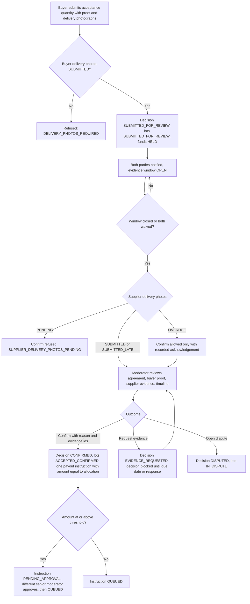
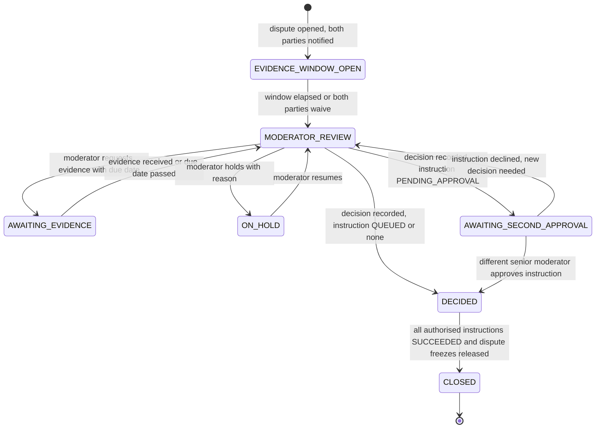

# Dispute and Moderation

How acceptance reviews and disputes are run: notices, evidence windows, moderator powers and limits, decisions, approvals and audit. Statuses are in the [State Machine](../03-technical-specs/TRANSACTION_STATE_MACHINE.md#2-canonical-enums); endpoints in [API 8 and 11](../03-technical-specs/API_SPECIFICATION.md).

## 1. Principles (CONFIRMED: SK-09, SK-17, SK-18)

1. No decision before notice and an evidence window. No moderator decision that affects acceptance, payout, refund or dispute outcome is final until both parties were notified and the applicable evidence window is closed (`CLOSED_ELAPSED`) or both parties explicitly waived it (`CLOSED_WAIVED`). One waiver is not enough.
2. No decision while a requested-evidence deadline is open, unless both parties waived.
3. Moderators decide; the backend executes. A moderator never edits the ledger or calls the provider.
4. Every action is audited with actor, role, timestamp, reason and evidence ids.
5. Deadline expiry opens a dispute or review. It never pays or refunds.
6. A moderator cannot act on a transaction where they are a party.
7. Disputed quantities are frozen. While a dispute is open nothing can pay or refund the disputed quantities except the single instruction that executes an approved decision of that same dispute; the freeze persists until that instruction succeeds ([State Machine 2.4](../03-technical-specs/TRANSACTION_STATE_MACHINE.md#24-lot-money-status-and-freezes)).
8. Moderators decide quantities, never amounts. For `RELEASE` and `REFUND` the backend computes the amount from the lot allocation. A moderator cannot award a partial price or a different sum ([OD-14](../06-delivery/OPEN_DECISIONS.md)).

## 2. Evidence windows

| Item | Rule |
|---|---|
| Default length | 48 hours from notice to both parties (PROPOSED, [OD-02](../06-delivery/OPEN_DECISIONS.md)); configurable per transaction category |
| Applies to | Acceptance reviews and disputes |
| Extension | Moderator may extend once, with a recorded reason; both parties are notified |
| Waiver | Each party can waive; the window closes early only when both have |
| Evidence requests | Moderator names the party, question and `due_at`; the decision stays blocked until the request is fulfilled or its due date passes |
| Notice content | What happened, affected items and quantities, current funds status (held, frozen), the evidence deadline, what each party can upload |

## 3. Acceptance review

*Diagram source: [`ACCEPTANCE_REVIEW_FLOW.mmd`](../diagrams/ACCEPTANCE_REVIEW_FLOW.mmd)*

Moderator checklist for an acceptance: both parties' delivery-photograph requirements (the buyer's must be `SUBMITTED` or `SUBMITTED_LATE`; the supplier's `SUBMITTED`, `SUBMITTED_LATE`, or `OVERDUE` which needs a recorded acknowledgement before confirming; `PENDING` blocks confirmation); agreement version and hash; buyer photographs against each agreed acceptance condition; supplier delivery photographs and dispatch evidence; receipt confirmation time; evidence flags (duplicate hash, missing or inconsistent metadata); history of earlier cases for both parties.

## 4. Dispute triggers and how they are handled

| Trigger | Reason code | Opened by | Scope | Moderator guidance |
|---|---|---|---|---|
| 72h dispatch deadline passed | `NO_DISPATCH` | System | Outstanding (undispatched) quantity only; dispatched quantity continues | Late supplier evidence is accepted as dispute evidence. Check dispatch declarations, tracking, buyer's statement. A tracking number is a declaration, not proof |
| Supplier did not confirm return within 72h of handover evidence | `RETURN_NOT_CONFIRMED` | System | Outstanding returned quantity | The timer starts at buyer handover. On a Lagos to Rivers return the parcel may still be in transit. Inspect tracking and both sides' evidence; do not treat expiry as supplier fault |
| Supplier contests the return | `RETURN_CONTESTED` | Supplier | Contested quantity, opened immediately | Compare handover and receipt photographs, serial or IMEI records, courier details |
| Moderator or party disputes an acceptance | `ACCEPTANCE_DISAGREEMENT` | Moderator, party | Quantity under review | Compare buyer proof with agreed acceptance conditions |
| Disagreement about specification or condition | `SPEC_DISAGREEMENT` | Party, moderator | Quantity | Decide against the immutable agreed conditions only |
| Disagreement about delivery or return | `DELIVERY_DISAGREEMENT` | Party | Quantity | |
| Suspicious or conflicting evidence | `SUSPICIOUS_EVIDENCE` | Moderator | Quantity | Senior review always required |
| Inspection period expired without a decision | `INSPECTION_PERIOD_EXPIRED` | System | Undecided received quantity | PROPOSED ([OD-01](../06-delivery/OPEN_DECISIONS.md)). Never auto-accept or auto-refund |
| Rejected quantity with no handover by deadline | `RETURN_HANDOVER_OVERDUE` | System | Rejected quantity | PROPOSED ([OD-04](../06-delivery/OPEN_DECISIONS.md)). Never auto-refund |
| Other irregularity | `OTHER` | Anyone | Quantity | |

Only the affected quantities are frozen by a scoped dispute. Unaffected quantities continue only if their own state and funds are independently safe. One open dispute exists per return; further outstanding quantity is added to it.

*Diagram source: [`DISPUTE_FLOW.mmd`](../diagrams/DISPUTE_FLOW.mmd)*

## 5. Decisions

A decision records per lot and quantity one outcome:

| Outcome | Effect |
|---|---|
| `RELEASE` | Lot becomes `ACCEPTED_CONFIRMED`; one payout instruction with the computed allocation amount; the dispute freeze stays until it succeeds |
| `REFUND` | One refund instruction with the computed allocation amount; the lot stays `IN_DISPUTE`, frozen, with `REFUND_PENDING` until provider success (see State Machine gap note) |
| Mixed decision ("split allocation") | Lines for different quantities of one item: some `RELEASE`, some `REFUND`. The lot is split by quantity first; each sub-lot follows its own line. Amount-level split of a single unit is not supported ([OD-14](../06-delivery/OPEN_DECISIONS.md)) |
| `REDISPATCH_OR_REPLACEMENT` | Only where both parties agreed (recorded consent statements); the decision sets a new dispatch deadline ([OD-10](../06-delivery/OPEN_DECISIONS.md)). No amount |
| `NO_FINANCIAL_ACTION` | Pending further evidence or none needed; prior status restored, dispute freeze released. No amount |

Every decision (and every acceptance confirmation) includes: written reason (at least 50 characters), `evidence_ids_considered`, decision maker, timestamp, any second approver. A changed mind is a new decision that supersedes the old one; nothing is edited. The chosen outcome must be supported by the agreed terms and the evidence.

## 6. Approvals

Approval attaches to the instruction, because the instruction carries the amount. An instruction is `PENDING_APPROVAL` when its amount is at or above `high_value_threshold_kobo` (₦500,000, `50000000` kobo, PROPOSED, [OD-07](../06-delivery/OPEN_DECISIONS.md)) or the decision has an acknowledged suspicious-evidence flag. The sequence is always:

1. Moderator decision or confirmation recorded (the instruction is created by the backend with the computed amount): instruction `PENDING_APPROVAL`, no ledger entry; for a dispute the case becomes `AWAITING_SECOND_APPROVAL`.
2. A different `SENIOR_MODERATOR` approves (`POST /mod/payouts/{id}/approve` or `/mod/refunds/{id}/approve`): instruction `QUEUED`, authorisation journal posts, dispute becomes `DECIDED`.
3. The worker submits (`SUBMITTED`) and the provider outcome is verified (`SUCCEEDED`, `FAILED` or `UNKNOWN`).

A senior moderator who declines (`/decline`, with a reason) cancels the instruction; a payout or return refund declined this way opens a dispute for the quantity (`ACCEPTANCE_DISAGREEMENT` or `OTHER`), and a dispute-origin instruction returns the dispute to `MODERATOR_REVIEW` for a new decision that supersedes the old one. Below the threshold a single moderator's decision is enough and the instruction is `QUEUED` at creation. A single approving action creates at most one payout and one refund, so the threshold cannot be avoided by slicing ([Security Architecture 6](../02-architecture/SECURITY_ARCHITECTURE.md#6-approval-thresholds-proposed)).

## 7. Moderator tools

| Tool | Description |
|---|---|
| Queues | Acceptance reviews (window open or ready), disputes, windows closing, awaiting second approval, financial exceptions |
| Case file | Agreement version and conditions, per-quantity timeline with server timestamps, evidence from both parties side by side, flags, party statements, previous cases |
| Actions | Assign, request evidence, extend window once, hold and resume, internal notes, flag evidence, confirm acceptance (with the supplier-photo acknowledgement when overdue), open dispute, record decision; senior moderators also approve or decline instructions |
| Disabled states | Confirm and decide are disabled with the reason shown (window open, request open, supplier delivery photographs pending, lot frozen by another case) |
| Audit viewer | Every action by actor, with before and after |

## 8. Service levels

Median decision time and moderator staffing are not yet confirmed. The target in [Product Requirements 7](../01-product/PRODUCT_REQUIREMENTS.md#7-success-criteria-proposed-targets) is PROPOSED. Staffing and SLA are OPEN ([OD-13](../06-delivery/OPEN_DECISIONS.md)). Holds raise reminders every 48 hours (PROPOSED).

## 9. Related documents

[State Machine 4.4 to 4.7](../03-technical-specs/TRANSACTION_STATE_MACHINE.md#4-transitions) · [Evidence and Files](EVIDENCE_AND_FILE_HANDLING.md) · [Notifications and Deadlines](NOTIFICATIONS_AND_DEADLINES.md) · [Financial Engine](../03-technical-specs/FINANCIAL_ENGINE.md)
